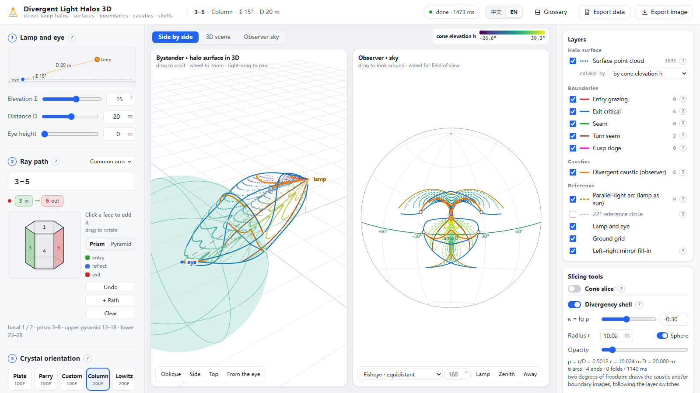
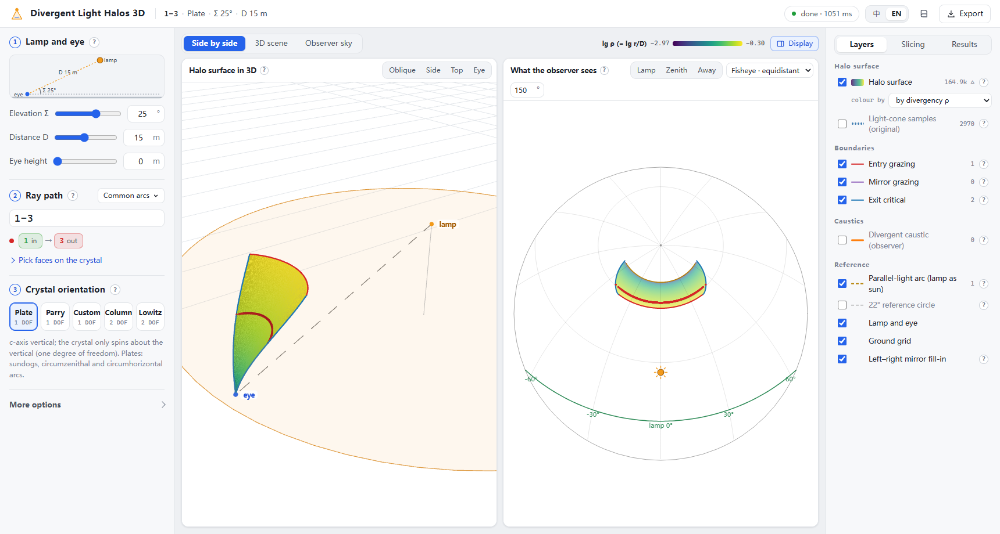

# Divergent Light Halos 3D

**English** · [中文](README.zh-CN.md)

Ice halos around a street lamp, in three dimensions. Sunlight arrives from one direction, so every crystal sees the Sun in the same place and a halo is an arc in the sky. A lamp is close by: each crystal sees it in a different direction, so the crystals that send lamp light into your eye fill a **halo surface** in space. This tool computes that surface, its boundaries and its caustics exactly, and shows them both from outside (3D) and as the observer sees them (sky view).

**Try it online: <https://galliumboride.github.io/Divergent-Light-Halo/>**

The whole tool is one HTML file. You can also download [`dist/DivergentLightHalo.html`](dist/DivergentLightHalo.html) and double-click it; it runs offline in any modern browser.




## What it shows

- **The halo surface.** Every crystal position from which lamp light, following the chosen ray path, reaches the eye. With one degree of freedom it is drawn as a triangle mesh whose edges are bisected onto the exact boundaries; with two degrees of freedom each cone layer is drawn as a curve, and after the first pass extra layers are added where curves exist, so the family is dense enough to read as a surface. Two-degree surfaces can also be drawn as a triangle mesh (Display settings → Halo surface → draw as: layer lines / surface / surface + lines; layer lines by default): neighbouring layers are stitched into triangles, the rows-and-columns idea of the one-degree mesh. Colour by the elevation h at which the crystal sees the lamp, by the divergency ρ = r/D (distance from the eye ÷ lamp distance), by path, or in one colour. The original window's light-cone sample points can be shown too.
- **Boundaries.** Where the surface ends because a condition becomes critical: the light grazes the entry face, grazes an internal mirror face, or reaches the exit face exactly at the critical angle. With two degrees of freedom: seams, turn seams and cusp ridges of the caustic surface.
- **The observer caustic.** The brightest lines in the observer's sky, where light from many crystals piles up. In space it is the outline of the surface seen from the eye. Optional: sky images of the boundaries and the asymptotic circles of unbounded surfaces. When there is no caustic, the results panel says why (none at all, behind the lamp, behind the eye …).
- **Parallel-light arc.** The classic arc the same path gives if the lamp were a sun at the same elevation. The divergent halo always touches it.
- **Cone slice.** One layer of the computation: the cone of light leaving the lamp at elevation h, and the crystals on it.
- **Divergency shell.** The halo curve on a sphere of radius r around the eye (ρ = r/D, κ = lg ρ), with arc ends, folds and cusps. ρ → 0 is the parallel-light halo, ρ → ∞ the anti-lamp profile.

Two views, side by side or one at a time: a **3D scene** (orbit, zoom, pan; oblique / side / top / from-the-eye presets) and the **observer sky** (rectilinear, four fisheye projections or a panorama; drag to look around; hover for azimuth, elevation and distance from the lamp). Under **Tools → Photo overlay** a real photo can be laid under the sky view to compare with (sky view only; load it, drag it onto the sky view or paste it). The sky is then framed to the photo's aspect ratio, so resizing the window does not shift one against the other, and at scale 1 the photo fills the frame (an all-sky fisheye photo at a 180° fisheye field has its image circle inscribed). The photo can be scaled, moved and rotated with sliders or, with “Drag photo” on, with the mouse (drag, wheel, Shift + drag); “Halo transp.” fades the simulated halo itself, while boundaries and the grid stay. The photo is kept in the browser (IndexedDB) and survives a reload.

You can choose:
- **Lamp and eye**: lamp elevation (−90° to 90°), lamp distance (1–300 m), eye height.
- **Ray paths**: type them (`3-5; 3-1-5`) or click faces on the crystal; several paths at once. Pyramid faces 13–18 / 23–28 included.
- **Orientation**: plate, Parry, any fixed ζ/θ (one degree of freedom), column with fixed c-axis tilt or Lowitz with fixed spin (two degrees of freedom). For two degrees of freedom you can pick which parallel-light curve to draw as the surface (caustic or one of the boundaries).
- **More**: quality, truncation distance, refractive index, pyramid apex angles.

Exports: a PNG of the current views with a title, and a CSV of every surface point (position, azimuth/elevation of the exact viewing direction, distances, h, lg ρ) plus all boundary, caustic and shell curves. A glossary explains every term in plain language. Chinese and English interface.

## How it works

Coordinates: Z up, lamp L = (D cos Σ, 0, D sin Σ), eye E = (0, 0, h_eye), crystal orientation R = Rz(α)·Ry(ζ)·Rz(θ).

- **One degree of freedom — light-cone method.** For every incidence elevation h at the lamp, the incoming direction is û = Rz(ψ)·(−cos h, 0, −sin h). Deviation is symmetric about the vertical, so the outgoing direction is Rz(ψ)·d(α, h). The two-focus condition (E − L lies in the plane of û and the outgoing ray) becomes P sin ψ + Q cos ψ = R, solved in closed form; the crystal then sits at P = L + t·û with t from a 2×2 solve. A second sweep (for each α and ψ, bisect for h) fills the thin bands the first one misses.
- **Surface mesh.** Built row by row in h. On each row the valid α-intervals of each ψ branch are found exactly (sign changes of the validity margin bisected to 1e-13; intervals thinner than the sampling are found from local maxima of the margin and tracked from the neighbouring rows). Inside an interval the nodes follow α = α_a + (α_b − α_a)(1 − cos πτ)/2. Next to the exit-critical boundary and where the two ψ branches fold together the position varies like √(α − α_a); with α − α_a ∝ τ² it becomes a smooth function of τ, so the square-root singularity is absorbed by the coordinate rather than by refinement, and the boundary nodes are the exact roots (the two branches share them and join without a seam). Whole rows are inserted where neighbouring rows are far apart in 3D or in the sky, where the boundary bends, or where the intervals do not match one to one (an interval is born, dies, splits or merges); intervals are matched with an allowance of 20·Δh, because a thin interval can move further than its own width. Rows also continue past the coarse scan while intervals remain, so thin wedge tips are not cut off. Neighbouring rows are joined as quad strips: no T-junctions, and the exact boundary points lie on the mesh to 1 mm. Line intersections use |û × ê|² rather than 1 − (û·ê)², which keeps full precision when the two rays are nearly parallel (crystals far away). Regions thinner than the coarse scan are found from local maxima of the validity margin along each column and row (plate crystals under a low lamp exist only in a band of h just below Σ, 0.14° wide at Σ = 2°), and the minimum row spacing scales with |h| near horizontal rays. When the lamp is at eye height and every face on the path is vertical (plate prism paths), only horizontal rays connect lamp and eye and ψ becomes a free parameter: the surface is a flat region in the lamp–eye plane, meshed in (ψ, β = α − ψ), drawn in the sky as an arc on the horizon, with its boundary lines taken from the exact interval ends.
- **Surface mesh — shell method (used for one and two degrees of freedom, `engine/shellmesh.js`).** The task is to cover the halo surface with triangles whose edges include the boundaries and creases exactly, with the correspondence between neighbouring slices given by the parameterisation. The tool is the divergency shell centred at the eye: a shell cuts the surface in a contour computed by the shell engine in closed form with Newton correction, each shell directly. Why not slices of constant h: those cones have the vertical line under the lamp as their axis and the eye is a singular point of that family — the point from which the observer's sky is seen; shells are centred at the eye, where the surface is the cone over the parallel-light arc, every shell cuts the same shape and the family is regular down to r → 0. Steps:
  1. **Shells**: uniform in ln r, plus a shell on each side of every critical radius (extremes and end points of the distance from the eye along the 3D boundary lines — the only places where the topology of a slice changes) and of the lamp shell.
  2. **Special points and special lines (the skeleton)**: on each contour — end points (ends of open arcs, where another boundary is hit), folds (where the contour turns back in the sky: the chords a short walk before and after meet at more than 120°; away from the eye a crease often becomes a rounded corner — a radius of a tenth of a degree or two, invisible to a short walk — so the walk is doubled from a quarter of the sky step up to one sky step, where 100° also counts; the longer walks are used only on arcs at least 8 times (loops 16 times) longer, not on loops of a degree or two next to the lamp; on a loop a corner straddling the start point is not split in two), foci (a whole stretch mapped to one point) and truncation points. The 3D boundary lines computed directly by the engines (two degrees of freedom: entry-grazing / exit-critical / seam / turn / cusp-ridge lines and rims from the light-cone boundary engine; one degree of freedom: boundary engine v4) are part of the skeleton: each end point is labelled with the line it lies on and its position along it (one line often comes in several coincident copies — any shared line counts; the tolerance scales with r because all boundary lines meet at the eye). Special points of neighbouring shells are linked by type and label (labelled ones only to the neighbouring crossing of the same line, unlabelled ones to the nearest unambiguous one in 3D), giving the special lines: boundary lines, fold lines, focal lines.
  3. **Triangles from the parameterisation**: each contour is split at the special lines present on both shells; pieces whose two ends lie on the same pair of special lines correspond and are zipped by fraction of arc length within the piece. Each shell's vertices are fixed (all special points plus uniform samples at the point spacing) and shared by the strips above and below; special points are vertices, special lines are edges, and the points of a 3D boundary line between two shells are inserted as vertices (the mesh edge is the exact boundary line). No guessing of correspondences by nearest points in the sky.
  4. **Refinement**: pieces or special points that do not correspond (a special line starts or ends between the shells = topology change) → bisection to a relative width of 5e-4; corresponding points more than 3 point spacings (at least 1.2°) apart in the sky, a boundary line bulging between two shells, radial curvature over three shells beyond 1 cm + 0.1% r, or a too large radial step near the lamp → a shell in between. The point spacing follows from the sky length of the parallel-light arc (the slice as r → 0) and the vertex budget, 0.35°–0.8°.
  5. **Topology changes** (two shells almost coinciding, or the pair around a critical radius): pieces that do not correspond are capped if small and otherwise stitched point by point to the nearest points; the pair around the lamp shell is closed onto the lamp (the surface has an apex there).
  - The engine sometimes returns one contour in several runs (a boundary image breaks where one σ branch ends and the other continues; the runs share an end point): runs are joined end to end before special points are sought — such a joint is not an end point and lies on no boundary line.
  - Fold lines: e.g. on the entry-grazing surface of 3-5 Lowitz Σ15.5 every contour has a pair of sharp folds, forming a fold line from the eye to the lamp that the light-cone boundary engine does not have (the nearest boundary line is 0.3–3 m away). Fold lines are now drawn in the cusp-ridge colour (with its switch) and are edges of the mesh. The lower pair of creases is sharper than the point spacing next to the eye (128° of turning within 0.01° at r = 3 m) and rounder further out (40° within 0.03°, 116° within 0.3° at r = 10 m), up to 0.4 m before the lamp where the tail of the contour vanishes; with one short walk the fold lines stopped at 7.9 m (half way), with the multi-scale walk they reach 14.6 m (lamp distance 15 m). When the points that trigger at the smallest scale of a cluster fall into several runs (two folds closer than one long walk, merged into one cluster by it), each run gives a fold — on the exit-critical surface of 3-5 Lowitz Σ10.5 two pairs of fold lines are only a few tenths of a degree apart in the last metre before the lamp, and on some shells they used to merge into one fold, breaking the lines into pieces. Folds come in different shapes: cusps (next to the eye, turning back within a few samples), hairpins (exit-critical surface: 10° of turning within 0.003°, 157–176° within 1° — the contour does turn back, the crease is just round, radius about 0.05–0.1°) and corners (3-5 entry surface away from the eye: 115–136°, not quite turning back); all count as fold lines. Not drawn: short chains whose radial extent is under 15% of their radius (unless they touch the end of a chunk) — mostly false folds where a shell is tangent to the surface at a saddle: two crossing contours reconnect at the tangent point as )(, and just after it the vertices of the hyperbolas are as sharp as cusps (175° at every scale) but blunt within a small change of radius, while the surface itself is smooth there (the pair at r 3.16–3.54 m on the entry-grazing surface of 3-4-5 Lowitz Σ10.5, sweeping 30° across the sky). They are still mesh vertices, just not drawn as creases.
  - Turn-back bands: where the surface reaches its farthest (or nearest) point from the eye between two shells, two contours of one shell (or the two sides of one loop) merge and vanish before the next shell, which has nothing there; the band between them used to be left open (3-5-6-8 Lowitz Σ10.5 caustic: the surface is tangent to the shell r = 17.32 m along a whole ring, leaving a white ring 25° around the lamp in the sky and a slit in 3D). Points of a shell that match nothing on the next shell and have no partner there are now sewn to another contour of the same shell, or to a far-away stretch of the same contour (the band lies on that shell's sphere, within the radial spacing of the true surface).
  - Focal lines: on some paths a whole stretch of the caustic on one shell maps to a single direction (σ constant, sky diameter ~1e-6°; one branch of 3-5 column ζ−90, the whole caustic of column 3-4-5 ζ−90). Light from a whole curve of orientations goes to one point — a focus, brighter than a caustic; the foci of all shells form a focal line, drawn thicker in the surface colour. It coincides to 1e-5 m with the 3D lines found independently by the light-cone boundary engine (which labels them cusp ridges / seams).
  - A caustic running along a boundary: one branch of Ĵ = 0 of Lowitz 3-4-5 coincides with the entry-grazing boundary over its whole length; its validity margin is only Newton noise (±5e-8). The valid region requires margin ≥ 1e-6: that branch lies on the edge of the region, and the end of a true caustic at a boundary moves inwards by 1e-6.
  - Arc ends with one degree of freedom: an exit-critical end is reached tangentially, and the tracer sometimes slid past a known end and stopped at an invented "missed end". The distance from the known end is now measured to each small segment of the arc (between neighbouring points), not just to its points (< 2e-3); the arc is cut and closed there. Small arcs next to a tip have only a few points and step over the end in one step (3-5 Parry Σ10, r ≈ 6.15: a false 5° arc with 4 points next to the true 0.04° arc). An arc whose correction fails very close to a known end (< 5e-3) is closed on that end.
  - Page: each ray path is cut along ln r into as many chunks as there are workers (chunk boundaries avoid critical radii and the lamp; both chunks compute their common shell and the meshes join there), drawn as they arrive. With two degrees of freedom the 3D boundary lines and rims are computed first (they are part of the skeleton), then the mesh; light-cone layers are not computed (only if the shell method fails, for the cone-layer stitcher). With one degree of freedom the light-cone samples are computed only when "light-cone samples" is switched on, and the (h, α) mesh only when lamp and eye are at the same height (possible flat case) or the shell method fails. About 70 shell lines are drawn, evenly by accumulated sky spacing.
  - Checks: `node test/mesh2/shellrun.mjs` (two degrees of freedom, 38 scenes) and `node test/mesh1/shellrun.mjs` (one degree of freedom, 13 ray paths × 14 lamp positions and orientations) compare the mesh with the surface computed by the other engine (the light-cone method), once in 3D and once in the observer's sky: mesh → surface (any triangle not on the surface) and surface → mesh (any layer line or exact boundary line not covered). With two degrees of freedom 30 of 38 scenes are zero on all six counts; with one degree of freedom 181 of 182 are fully correct (slowest 32 s on one thread). Remaining: a few metres of seam lines in 4-1-8 Lowitz Σ27 / Σ3.5 and 9 m of boundary lines on the 3-1-5 Lowitz entry-grazing surface are not covered, and boundary lines next to the eye in 4-1-8 Lowitz Σ10 miss 8° in the sky (all three as before); rim / exit-critical lines next to the eye in 1-3 column Σ52 miss 24° in the sky (0.5 m in 3D), and 2.8 m of boundary lines of the 3-1-5 Lowitz caustic are more than 10 cm from the mesh; the one-degree-of-freedom surface 1-3-2 Σ60 (covering the whole sky, 59 fold lines) has several small swallowtails on one contour and the fold detection picks different ones on neighbouring shells, leaving 4.6% uncovered; the four "seam lines" of Lowitz 3-4-5 run from the eye to the lamp where neither engine has any surface (spurious lines of the boundary engine in this degenerate case); paths with only a focal line (column 3-4-5) have no triangles to check; the light-cone method produces no slices along the ζ → 0 edge of the Lowitz family, so triangles there cannot be compared.
- **Boundaries (engine v4).** Each boundary family pins one point of the ray chain to a fixed circle, so it is a one-parameter closed form. Corners, turns and pinches are bisected to machine precision.
- **Drawn curves.** Every displayed line (boundaries, cone layers, edge tracks, caustics, shell arcs) is refined for display: points are added until neighbours are close in 3D, in the eye's view and in the lamp's view; the ends are bisected onto the exact place where the curve stops; pieces are joined only along the same ψ branch. The sky view uses each point's exact viewing direction (the reversed outgoing ray), never P − E, which loses all precision next to the eye. The surface mesh is drawn on the GPU through the chosen lens.
- **Two degrees of freedom.** At each h the lamp acts as a sun of elevation h, and each point of the chosen curve on the orientation plane is mapped onto the cone in closed form. The caustic Ĵ = J·√(exit margin) = 0 is traced by numerical continuation (predictor–corrector with step control), not assembled from a marching-squares grid: the grid only supplies seeds (sign changes on cell edges, and local minima of |J| for loops smaller than a cell). The tracer goes straight through crossings, steps over singular points where the gradient vanishes, bisects onto the exact boundary where it leaves the valid region and then solves the end exactly, so layer curves no longer stop part-way, retrace themselves or zigzag. A loop is closed only when the tracer comes back to its start heading the same way (a thin U-shaped zero line also passes its start, heading the other way), and a trace stops when it lands back on its own path, so a near-crossing cannot send it round a loop forever. The surface's edges (endpoint tracks and rims) are curves in (h, orientation) and are followed by pseudo-arclength continuation (Keller): h is one of the unknowns, the predictor steps along the tangent (the null vector of the Jacobian) and the corrector solves the equations on the hyperplane normal to it. Where two endpoints merge and vanish at some h (a fold in h) the edge turns round and continues on the other branch, instead of stopping at the fold with an end that is only √(bisection step) accurate. Points between two samples are found on the hyperplane normal to their chord, which also works across a fold. Cusp ridges are also seeded from the traced caustics every 2° (where the sky image of the curve reverses), because the endpoint engine only looks for cusps along arcs that start at an endpoint, and a closed caustic loop has none; layer lines fold back at these cusps. On a grazing surface the layer curve is refined along the grazing curve itself: midpoints are taken on the chord of the curve's own coordinate (a unit vector in the crystal frame) and projected back onto the curve, not on the chord in (α, ζ), which leaves the surface wherever the curve bends sharply in those coordinates; a curve that is a full circle is closed back to its first sample. Orientation coordinates are read with the known spin removed first, so they stay defined when the c-axis is vertical (in Lowitz mode that is where the two branches meet at the edge of the reachable band). On the exit-grazing surface the exit direction is computed with the exit margin set to exactly zero, since √(margin) would turn rounding errors of 10⁻¹⁶ into direction noise of 10⁻⁸. At a fold of the cone map the two branches are replaced by their mean (the √ terms cancel), so layer lines close up there. Boundary lines are refined until the midpoint of every segment lies within 10⁻⁴ of the scene size of the chord. When a traced caustic is a whole coordinate line x_j = c (the fold at a symmetric orientation, e.g. roll 60° in a column crystal, where orientations c ± δ map to the same sky point and J vanishes along the whole line), its rim is where that line leaves the valid region and is solved directly as { x_j = c, margin = τ }: the general { Ĵ = 0, margin = τ } is ill-conditioned there, because at the symmetric orientation entry and exit angles are equal, so the exit margin is about the square of the entry margin and Ĵ = J·√(exit margin) is squeezed twice. For 3-1-5-7 in a column crystal this took the rims from 7 s to under 2 s (25 s → 2 s at ζ −90°, Σ 20°) and closed their gaps. An endpoint where the caustic meets a curve must be an isolated crossing: |Ĵ| a short step along the curve has to be within 10⁻⁴ of |Ĵ| a step off it. On a stretch where the exit margin is zero throughout (e.g. 3-1-5-7 in a column crystal, where entry grazing implies exit grazing) Ĵ = J·√(exit margin) vanishes along the whole curve and its sign changes are rounding noise; those are no longer taken as endpoints, which removed loops of boundary line floating away from the surface. Extra layers are placed by equidistributing the 3D spacing measured between the first-pass layers (more where layers are far apart, none where they crowd, e.g. near h = ±90° where the cone degenerates), and layers crowded closer than 0.3× the median spacing are not drawn. All layers converge on the lamp, so their 3D spacing still grows roughly in proportion to the distance from it. In the 3D view this is evened out with supplementary layers, as with supplementary contours on a map: where two neighbouring layers spread apart, a layer at the mid elevation is computed and drawn only over that stretch. It fades in point by point (opacity = smoothstep of the local spacing from 1.4 d* to 2.4 d*, with d* = 0.75 × the median spacing), so the density of ink stays within about 15% instead of doubling where a supplementary line starts. This is repeated up to three levels; the trimming runs in the workers. The sky view keeps the full layers only. With “draw as: surface” all full layers (sorted by h) are stitched pairwise into triangles in the workers: rows are the layer curves (their ends already lie exactly on the boundaries), columns the position along them. The one-degree mesh has a shared parameter α to line up two rows; two degrees have none, so the orientation plane (u, v) picks the matching curve and branch: neighbouring layers differ by a fraction of a degree in h and their curves move only slightly in (u, v). The two branches of the cone map coincide in (u, v) (one orientation, two landing points), so the (u, v)-nearest point is taken on each branch and the branches are compared in 3D. This separates them where a whole layer lies on the fold line (roll 60° in a column crystal), where both branches are the same segment in (u, v), and joins them across the layer whose cone passes through the eye, where the curve switches branch. Along the chosen curve the position is the 3D-nearest point (local descent), because orientation → position can be strongly sheared: on the fold line 2° of u takes the curve from the lamp to 80 m out, and the next layer is shifted by 0.7° in u, so “the same orientation” on two neighbouring layers can be tens of metres apart. Matched stretches are zipped into triangles. The zipper has to pass through the point-by-point matches (rungs) and takes the shorter diagonal only between them: a purely greedy zipper, where both layers are U-shaped loops and the outer one is larger (its whole tip stretch matches the tip point of the inner one), fans from one outer vertex to the far arm of the inner loop, covering the inside of the loop and leaving the band between the loops empty. The edge-length limit of the triangles follows the matching distances of the stretch itself, and landmark pairs and cap ends, which are topologically certain, are exempt from the maximum-connection-distance safeguard (where a boundary line runs almost along the layers a layer end can be eight or nine metres from the next layer, and dropping those triangles leaves a wedge beside the boundary line); the wedge left where two layers end obliquely on the same boundary is closed with a fan, and where a layer passes through the lamp (a pinch point) the fan closes onto it. The exact boundary lines, turn seams, cusp ridges and rims (feature lines) are required to be mesh edges: a layer vertex lying on a feature line (an end, a fold-back point, a kink) is a landmark, neighbouring landmarks of two adjacent layers along the same feature line are forced to correspond, the stitching is cut there into two runs (one on each side), and the segment joining the two landmarks becomes the edge they share; where the feature line bends strongly between two landmarks (far out a boundary runs almost along the layers, so the landmarks of adjacent layers are metres apart) its own points are inserted into the mesh. Without this constraint, where a layer folds back on a cusp ridge its two arms coincide in 3D, the greedy zipper joins one layer's cusp point to a vertex before the next layer's cusp point and fans back from the returning arm, leaving a row of triangular notches with their bases on the ridge; and a crease crossing the layers obliquely is cut short by the triangles. Normals are computed per corner with a crease angle of 60°, so two sheets sharing vertices at a fold are shaded separately. Where the topology of the level lines of h changes between two neighbouring layers the zipper has nothing to match, and three steps close the gap. (1) Caps: two curve ends of one layer lie next to each other on the same boundary line and the stretch of boundary between them stays between the two layers in h (the boundary bulges between the layers, one layer line is cut in two there and the neighbouring layer's line passes by in one piece); before stitching, that stretch of boundary is zipped directly to the facing stretch of the neighbouring layer, also across a junction of two boundary lines. (2) Curves of the two cone-map branches that meet end to end in one layer are joined into one (the branches meet on the fold line; stitched separately they leave a row of slivers along it and a closed layer line never becomes a ring), and a curve lying entirely on another curve of the same layer is dropped. (3) Cleft filling, the standard second step of reconstruction from contours (Barequet–Sharir): open edges (edges of a single triangle) that do not run along a feature line are defects; defect edges plus the stretches of feature lines not yet attached to the mesh form a graph, the shortest cycle through each defect edge (confined to a few neighbouring layers) is the boundary polygon of a cleft, and it is filled by a minimum-area triangulation (interval dynamic programming). This closes the cap inside an innermost closed layer line, the piece beyond the first or last layer up to the junction of the boundary lines, and whatever the zipper left; where a cusp ridge ends in mid-surface the polygon is cut along the ridge so that both sheets are filled up to it. A fill is rejected if it would give an edge more than two triangles, repeat an existing triangle, or fold back onto existing triangles (the outline of an isolated patch, not a hole). `node test/mesh2/run.mjs` runs two checks over 34 scenes (different ray paths, orientations, lamp elevations and surface types): neighbouring landmarks along every feature line must be joined by mesh edges — of 19,211 such links 0 lack a vertex, 5 an edge and 2 have the feature line off the mesh (about 989 / 744 / 1059 before the feature constraint); and open edges must lie on feature lines — the total length of open edges off the feature lines is 873 m (measured with the page's layer-insertion round; 1296 m for the previous version measured the same way, about 2850 m before cleft filling). Fill cycles may pass through the two pinch points, lamp and eye (the common end of the layer lines, and of the boundary lines that start or end there): the cap beyond the last layer often closes on the lamp, and the lens-shaped strip between the two layers on either side of the cone through the eye closes on lamp and eye. Layer edges whose two triangles lie on the same side (an overlap) with nothing on the other, and layer edges with no triangle at all, also count as cleft boundaries. The same kind of gap can show up only at some lamp elevations (column 4-1-8: at Σ 3.5° the layer ends are just within the distance limit of the next layer, at Σ 1° they are beyond it), so the suite holds one path at a range of Σ from 0.5° to 45°. Where two neighbouring layers cannot be matched (a curve is born, dies or switches to the symmetric set of orientations between them) a layer is computed half-way and the pair is stitched again. Where the next layer has no curve at all near a stretch (not even a (u, v) candidate), the stretch is matched one or two layers further on, with the 3D distance limit tightened by the h skipped (0.05 D + 10 r Δh) so that real holes are not bridged. The part of the layer along the eye–lamp line beyond the lamp used to be missing from several layers in a row around h ≈ −Σ (a slit tens of metres long behind the lamp); the layer computation now finds it. Where a crystal sends the light almost straight back (the parallel-light sky direction passes the antisolar point; likewise near the sun direction) the lamp ray and the outgoing ray are parallel and the cone map throws the point to infinity along the eye–lamp line: that stretch runs from the lamp out to the maximum distance yet occupies an extremely narrow interval of the curve parameter (at angle δ from the pole direction the point is about D/δ away), narrower still as h → ∓Σ, and when two neighbouring samples both fall outside it both ends look invalid and neither refinement nor end bisection can see it. In layers whose cone is within 6° of the eye–lamp line, each curve is searched for the place where its sky direction is closest to the sun or antisolar direction (ternary search), and a ladder of successively halved samples is inserted on either side, so that even the narrowest window receives a few. In the sky view triangles spanning more than 25° are subdivided on the sphere (up to four levels; fans converging on the lamp are legitimately large), and those spanning more than 60°, almost always a wrong match, are left out, so straight-line projection cannot stretch them into sheets across the sky. Known limits: the remaining open edges are mostly in three places — a small ring right at the eye on the layer whose cone passes through it (h ≈ Σ; the surface goes through the observer there and nothing is filled within the pinch radius 0.02 D, which from the eye looks like a small wedge on either side of the lamp), single long edges far away (where neighbouring layers are tens of metres apart), and regions where two sheets coincide in 3D (both arms compete for the same arm of the next layer; overlapping triangles are tolerated there rather than leaving gaps). A strict manifold rule (at most two triangles per edge) was tried and left a row of gaps in such regions, so it is not used; thin slits remain in the sky near h ≈ 0 on the entry-grazing surface of Lowitz crystals (the closed-form grazing-curve sampling does not resolve the stretch whose width is ∝ |sin h|; the layer lines have the same gap).
- **Speed of the two-degree-of-freedom boundary lines (light-cone boundary engine).** It used to waste work in three places. (1) To find cusp ridges on closed caustic loops (and the rims), the whole caustic is traced every 2° of h; seeds are the sign changes of J on the edges of an orientation-plane grid, and every seed was bisected 40 times before checking whether it was of any use — almost all lie on a line already traced or outside the valid region and were thrown away. Now the bisection stops early when the whole bracket of the root is within 2e-3 of a traced line (the distance to a line is 1-Lipschitz in position), or when a validity margin divided by its Lipschitz bound is below −(half the bracket) (the whole bracket is invalid; face normals turn at unit rate with an orientation angle, so |dg0| ≤ 1, after refraction |dP| ≤ 3 + n, each reflection |dP′| ≤ 3|dP| + 4n, |dq| ≤ |dP| + n) — the verdict is exactly that of bisecting to the end. (2) Every evaluation of the caustic function computed the six trigonometric functions of the crystal frame and the ray chain twice and allocated some twenty small arrays (a tenth of the time in garbage collection): the sines and cosines are cached per angle (along a grid row or a grid edge only one angle changes), Ĵ and the validity margins reuse the chain already computed in jana3, and N_a / N_b no longer allocate. (3) Each of the two branches of the cone map was refined separately, solving the midpoint of the same pair of samples (a Newton solve of the endpoint each) twice: midpoints are now memoised. In addition, a grazing surface no longer computes the caustic–curve intersections it does not use (the bulk of the parallel-light endpoint search). Over the 38 test scenes the boundary lines went from 46.6 s to 18.7 s and the rims from 26.9 s to 11.5 s, grazing surfaces about tenfold (0.19 s → 0.02 s); in the page the boundary lines of 4-6 Lowitz take 1.0 s instead of 2.6 s, column 3-4-5 0.85 s instead of 5.0 s. None of this changes any computed number: boundary lines, rims, layer lines and parallel-light arcs of all 38 test scenes are bit-identical to before.
- **Two-degree-of-freedom boundary lines: two fixes.** (1) Endpoint tracks continued in h with Newton solves are refined by re-solving at intermediate h; starting from one end, Newton can converge to another intersection, which the cone map turns into a point tens of metres away. A new solution must now lie near both end solutions (within twice their distance), otherwise the other end is tried as a start, and if that fails no point is inserted. (2) Where the boundary of the reachable band shrinks to a point (Lowitz with a horizontal lamp ray, h → 0: the lower band edge ê·w = −1) the lift ρ = Rᵀg is 0/0, a difference of two numbers of order 1/|h|, and the sky direction is rounding noise; ρ must be a unit vector, so a deviation of |ρ| from 1 above 1e-6 now counts as no solution. Examples: on the seam surface of 3-1-5-8 Lowitz Σ10.5 the turn seam used to end with a jump of 54.6 m (to y = ±51.6 m, while the whole line lies in the vertical plane through lamp and eye), drawn as a V across the surface after mirroring; the turn seam of the 3-5 Lowitz Σ20 caustic ended in a 0.2 m cloud of noisy points in the plane h = 0 — both are gone (longest segment 54.6 m → 0.13 m). The boundary lines of the other 38 test scenes are unchanged (cusp ridges differ by ≤ 1e-4 m).
- **Observer caustic.** χ(ξ) = det(ξ, F(ξ), DF⁻¹(ŵ×F) − ŵ×ξ) = 0 is a curve that does not depend on the lamp; the lamp only pairs the azimuth on the cone and decides what is visible. Points solved along the zero curve are chained by continuity; where a segment cannot be continued to the next sample (the two α branches merge at a double root, or the branch leaves the visible region or the maximum distance) the zero curve is bisected between the two samples down to the last point that still connects. Near a double root the position varies like a square root of the parameter and neighbouring samples can be metres apart, so without this the two branches stop short on either side of their meeting point and the caustic line has a hole (the two-degree-of-freedom tracer lacked this step: 8 m were missing for column 4-1-8 at Σ 30°). Long steps inside a segment are refined with midpoints on the zero curve.
- **Divergency shell — cusps.** Cusps of the two-degree-of-freedom caustic on a shell (purple stars) are found from the sign change of the sky tangent: T = d(view direction)/ds passes through zero and reverses at a cusp (T ≈ (s − s₀)·v), independently of the sampling — where T changes sign between two neighbouring points, the secant method on the state chord between them finds the sign change and the point is inserted into the arc; a sharp bend (T turns but does not shrink) does not count. The C# original only checked whether two adjacent chords reverse, which needs a sample exactly at the cusp, and of a symmetric pair often only one was found (34/62, 26/70 and 14/43 of the crossings of the 3D cusp ridges with the shells); an intermediate version used minima of the sky speed and needed dense sampling. Traced and transported shells now use the same criterion and the cusps match the 3D ridges shell by shell (4-6 Lowitz 9/9 shells, 4-1-8 Lowitz Σ3.5 8/8), within 1 mm. The "cusp ridge" of 4-1-8 column ζ−90 is in fact a focal line (see above).
- **Divergency shell.** On a shell the halo curve is the zero set of one quadratic Φ_ρ(w) = (S + ρe_z)² − 2ρ p u_z (S + ρe_z) + (ρ² − 1) u_z² on the crystal-frame sun sphere, cut by the path's boundaries; arcs are continued from their ends.

Nothing is estimated from random ray-tracing samples.

The engines in `src/engine/` are line-by-line JavaScript ports of the author's C# engines (the "Divergent Light Halos 3D" window of a private WinForms simulator, its divergency-shell and observer-caustic engines, and the light-point endpoint engine). They were cross-checked against the C# originals on 17 + 56 + 44 test cases (with the display refinement switched off): counts of points, curves, ends and flags are identical; coordinates agree to rounding (the remaining 1e-13 … 1e-6 m come from last-bit differences between the .NET and V8 sin/cos/atan2).

## Build from source

```bash
npm install
```

```bash
npm run build
```

This writes `dist/DivergentLightHalo.html` (one file with CSS, JavaScript, the Web Worker and three.js inlined) and a copy at `docs/index.html` for GitHub Pages. `npm run watch` rebuilds on change; `npm run serve` serves it at <http://127.0.0.1:5179>.

```
src/engine/   crystal.js (faces, paths, orientation)  cone.js (light-cone method, parallel arc, cone slice)  mesh1.js (surface mesh)
              bdry4.js (boundary engine v4)  epdiv.js (two degrees of freedom)  obscaustic.js (observer caustic)
              divshell.js (divergency shell)  lp.js / ep.js / aperture.js (light-point engine, shared with Light-Point-Trace)
src/worker.js computation worker (tasks are split across a worker pool)
src/app/      main.js (state, compute orchestration, panels), scene3d.js (three.js), sky.js (observer sky),
              crystal.js (clickable crystal), strings.js + terms.js (zh / en text and glossary)
```

Related: [Light-Point Halo Tracer](https://github.com/GalliumBoride/Light-Point-Trace) (parallel light, exact arcs, endpoints).

## License

[MIT](LICENSE)
