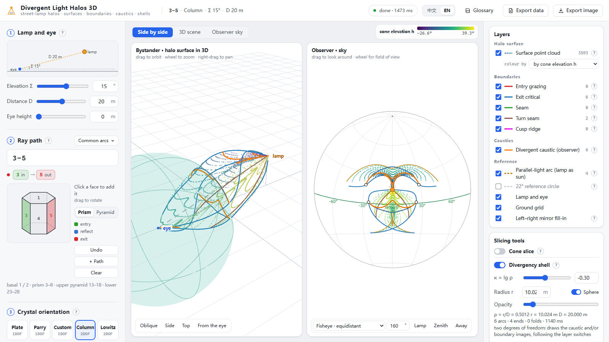
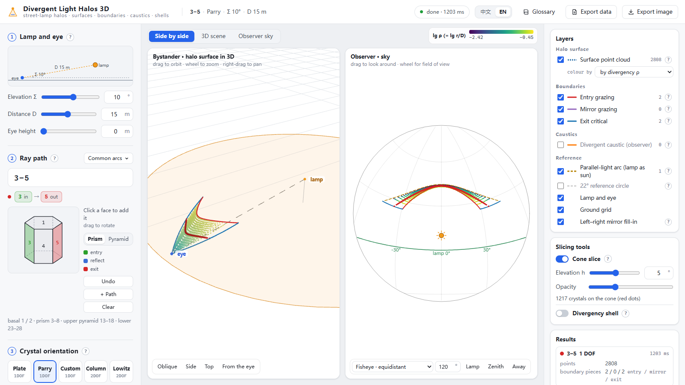

# Divergent Light Halos 3D

**English** · [中文](README.zh-CN.md)

Ice halos around a street lamp, in three dimensions. Sunlight arrives from one direction, so every crystal sees the Sun in the same place and a halo is an arc in the sky. A lamp is close by: each crystal sees it in a different direction, so the crystals that send lamp light into your eye fill a **halo surface** in space. This tool computes that surface, its boundaries and its caustics exactly, and shows them both from outside (3D) and as the observer sees them (sky view).

**Try it online: <https://galliumboride.github.io/Divergent-Light-Halo/>**

The whole tool is one HTML file. You can also download [`dist/DivergentLightHalo.html`](dist/DivergentLightHalo.html) and double-click it; it runs offline in any modern browser.




## What it shows

- **The halo surface.** Every crystal position from which lamp light, following the chosen ray path, reaches the eye. Shown as a point cloud, coloured by the elevation h at which the crystal sees the lamp, by the divergency ρ = r/D (distance from the eye ÷ lamp distance), by path, or in one colour.
- **Boundaries.** Where the surface ends because a condition becomes critical: the light grazes the entry face, grazes an internal mirror face, or reaches the exit face exactly at the critical angle. With two degrees of freedom: seams, turn seams and cusp ridges of the caustic surface.
- **The observer caustic.** The brightest lines in the observer's sky, where light from many crystals piles up. In space it is the outline of the surface seen from the eye. Optional: sky images of the boundaries and the asymptotic circles of unbounded surfaces. When there is no caustic, the results panel says why (none at all, behind the lamp, behind the eye …).
- **Parallel-light arc.** The classic arc the same path gives if the lamp were a sun at the same elevation. The divergent halo always touches it.
- **Cone slice.** One layer of the computation: the cone of light leaving the lamp at elevation h, and the crystals on it.
- **Divergency shell.** The halo curve on a sphere of radius r around the eye (ρ = r/D, κ = lg ρ), with arc ends, folds and cusps. ρ → 0 is the parallel-light halo, ρ → ∞ the anti-lamp profile.

Two views, side by side or one at a time: a **3D scene** (orbit, zoom, pan; oblique / side / top / from-the-eye presets) and the **observer sky** (rectilinear, four fisheye projections or a panorama; drag to look around; hover for azimuth, elevation and distance from the lamp).

You can choose:
- **Lamp and eye**: lamp elevation (−90° to 90°), lamp distance (1–300 m), eye height.
- **Ray paths**: type them (`3-5; 3-1-5`) or click faces on the crystal; several paths at once. Pyramid faces 13–18 / 23–28 included.
- **Orientation**: plate, Parry, any fixed ζ/θ (one degree of freedom), column with fixed c-axis tilt or Lowitz with fixed spin (two degrees of freedom). For two degrees of freedom you can pick which parallel-light curve to draw as the surface (caustic or one of the boundaries).
- **More**: quality, truncation distance, refractive index, pyramid apex angles.

Exports: a PNG of the current views with a title, and a CSV of every surface point (position, azimuth/elevation from the eye, distances, h, lg ρ) plus all boundary, caustic and shell curves. A glossary explains every term in plain language. Chinese and English interface.

## How it works

Coordinates: Z up, lamp L = (D cos Σ, 0, D sin Σ), eye E = (0, 0, h_eye), crystal orientation R = Rz(α)·Ry(ζ)·Rz(θ).

- **One degree of freedom — light-cone method.** For every incidence elevation h at the lamp, the incoming direction is û = Rz(ψ)·(−cos h, 0, −sin h). Deviation is symmetric about the vertical, so the outgoing direction is Rz(ψ)·d(α, h). The two-focus condition (E − L lies in the plane of û and the outgoing ray) becomes P sin ψ + Q cos ψ = R, solved in closed form; the crystal then sits at P = L + t·û with t from a 2×2 solve. A second sweep (for each α and ψ, bisect for h) fills the thin bands the first one misses.
- **Boundaries (engine v4).** Each boundary family pins one point of the ray chain to a fixed circle, so it is a one-parameter closed form. Corners, turns and pinches are bisected to machine precision.
- **Two degrees of freedom.** At each h the lamp acts as a sun of elevation h; the light-point method traces the caustic (J = 0) or the chosen boundary on the orientation plane, and each point is mapped onto the cone in closed form. The surface's edges come from continuing the parallel-light endpoints along h.
- **Observer caustic.** χ(ξ) = det(ξ, F(ξ), DF⁻¹(ŵ×F) − ŵ×ξ) = 0 is a curve that does not depend on the lamp; the lamp only pairs the azimuth on the cone and decides what is visible.
- **Divergency shell.** On a shell the halo curve is the zero set of one quadratic Φ_ρ(w) = (S + ρe_z)² − 2ρ p u_z (S + ρe_z) + (ρ² − 1) u_z² on the crystal-frame sun sphere, cut by the path's boundaries; arcs are continued from their ends.

Nothing is estimated from random ray-tracing samples.

The engines in `src/engine/` are line-by-line JavaScript ports of the author's C# engines (the "Divergent Light Halos 3D" window of a private WinForms simulator, its divergency-shell and observer-caustic engines, and the light-point endpoint engine). They were cross-checked against the C# originals on 17 + 56 + 44 test cases: counts of points, curves, ends and flags are identical; coordinates agree to rounding (the remaining 1e-13 … 1e-6 m come from last-bit differences between the .NET and V8 sin/cos/atan2).

## Build from source

```bash
npm install
```

```bash
npm run build
```

This writes `dist/DivergentLightHalo.html` (one file with CSS, JavaScript, the Web Worker and three.js inlined) and a copy at `docs/index.html` for GitHub Pages. `npm run watch` rebuilds on change; `npm run serve` serves it at <http://127.0.0.1:5179>.

```
src/engine/   crystal.js (faces, paths, orientation)  cone.js (light-cone method, parallel arc, cone slice)
              bdry4.js (boundary engine v4)  epdiv.js (two degrees of freedom)  obscaustic.js (observer caustic)
              divshell.js (divergency shell)  lp.js / ep.js / aperture.js (light-point engine, shared with Light-Point-Trace)
src/worker.js computation worker (tasks are split across a worker pool)
src/app/      main.js (state, compute orchestration, panels), scene3d.js (three.js), sky.js (observer sky),
              crystal.js (clickable crystal), strings.js + terms.js (zh / en text and glossary)
```

Related: [Light-Point Halo Tracer](https://github.com/GalliumBoride/Light-Point-Trace) (parallel light, exact arcs, endpoints).

## License

[MIT](LICENSE)
