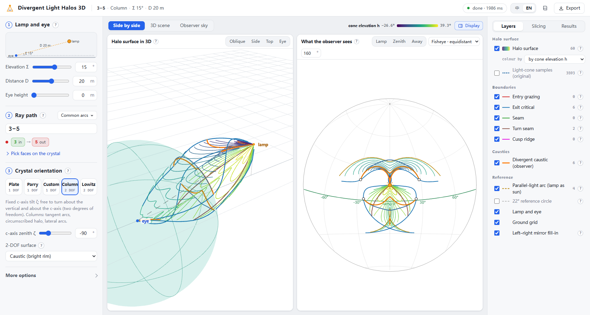
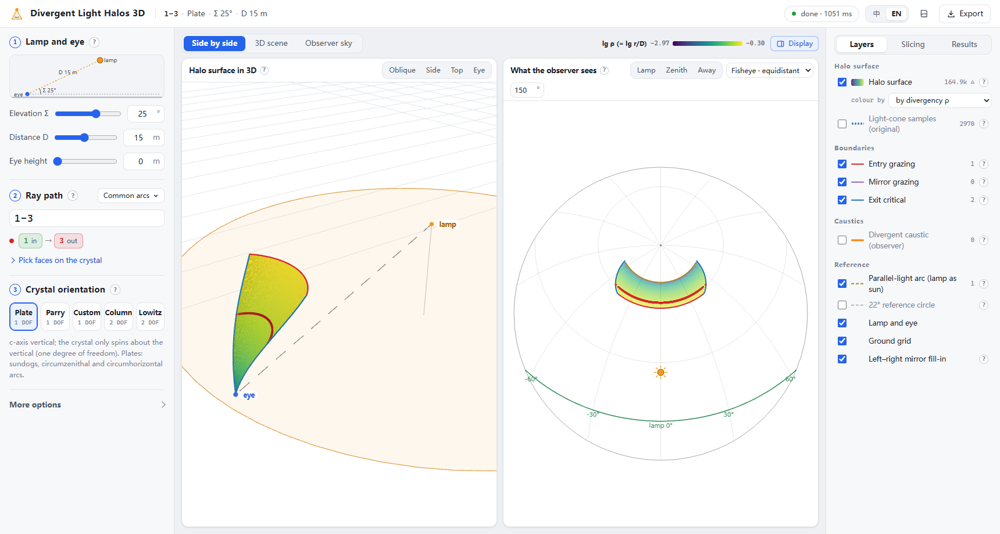

# 发散光晕 3D

[English](README.md) · **中文**

路灯下的冰晕, 三维的. 太阳光从同一个方向来, 所有冰晶看到的太阳都在同一处, 所以晕是天上的一条弧. 路灯就在近处: 每个晶体看到灯的方向都不一样, 能把灯光送进眼睛的晶体在空间里铺成一张**晕面**. 这个工具精确地算出晕面、它的边界和焦散, 既从外面看 (3D), 也按观测者看到的样子画 (天空视图).

**在线使用: <https://galliumboride.github.io/Divergent-Light-Halo/>**

整个工具是一个 HTML 文件. 也可以下载 [`dist/DivergentLightHalo.html`](dist/DivergentLightHalo.html) 双击打开, 任何现代浏览器离线可用.




## 能看到什么

- **晕面**: 灯光沿所选光路能进入眼睛的全部晶体位置. 一自由度画成三角网格, 网格边缘二分到精确边界上; 二自由度每个光锥层画成一条曲线. 着色可选: 晶体看灯的仰角 h、发散度 ρ = r/D (离眼距离 ÷ 灯距)、按光路、单色. 也可以显示原窗体的光锥采样点.
- **边界**: 晕面在哪里终止 — 光擦着入射面、擦着内部反射面、或在出射面正好处于全反射临界角. 二自由度时还有接缝、转折缝和焦散曲面的尖点脊线.
- **观测者焦散**: 观测者天上最亮的线, 很多晶体的光挤到同一方向; 在空间里是晕面从眼睛看过去的轮廓. 可选画出边界的天空像和无界晕面的渐近圆. 没有焦散时, 结果栏会说明原因 (真的没有 / 在灯后方 / 在眼后方 …).
- **平行光弧**: 把灯换成同一仰角的太阳时这条光路的经典弧, 发散光晕总有一边贴着它.
- **锥切片**: 计算里的一层 — 以仰角 h 离开灯的光锥, 以及锥上的晶体.
- **发散度球壳**: 以眼为心、半径 r 的球面上的晕线 (ρ = r/D, κ = lg ρ), 标出弧的末端、折叠和尖点. ρ → 0 是平行光晕, ρ → ∞ 是反灯点剖面.

两个视图, 可并排也可单看: **3D 场景** (旋转、缩放、平移; 斜看 / 侧面 / 俯视 / 从眼睛看) 与**观测者天空** (直线、四种鱼眼或全景; 拖动转向; 悬停读方位、仰角和距灯角距).

可以设定:
- **灯与眼**: 灯仰角 (−90° 到 90°)、灯距 (1–300 m)、眼高.
- **光路**: 直接输入 (`3-5; 3-1-5`) 或在晶体上点面; 可多条同时算; 含锥面 13–18 / 23–28.
- **取向**: 板晶、Parry、任意固定 ζ/θ (一自由度); 固定 c 轴倾角的柱晶、固定自旋的 Lowitz (二自由度). 二自由度时可选用哪条平行光曲线做曲面 (焦散或某条边界).
- **更多**: 精度、截断距离、折射率、锥晶顶角.

导出: 当前视图连同标题的 PNG; 全部晕面点 (位置、从眼看的方位/仰角、距离、h、lg ρ) 与所有边界、焦散、球壳曲线的 CSV. 术语表用大白话解释每个名词. 界面中英文.

## 怎么算的

坐标: Z 朝上, 灯 L = (D cos Σ, 0, D sin Σ), 眼 E = (0, 0, 眼高), 晶体取向 R = Rz(α)·Ry(ζ)·Rz(θ).

- **一自由度 — 光锥法**: 对灯处每个入射仰角 h, 入射方向 û = Rz(ψ)·(−cos h, 0, −sin h); 偏折绕竖直轴对称, 出射方向 = Rz(ψ)·d(α, h). 两焦点条件 (E − L 落在 û 与出射光张成的平面里) 化成 P sin ψ + Q cos ψ = R, 闭式求解; 晶体位置 P = L + t·û, t 由 2×2 方程给出. 再按 α、ψ 扫一遍 (每对二分求 h) 补齐第一遍漏掉的窄带.
- **晕面网格**: 在 (h, α) 参数平面上铺网格, 每个格点闭式定位; ψ 两支各有一个有效余量 (入射/镜面/出射判据、根存在、t, s > 0、截断). 跨零的三角形沿边二分裁剪, 所以网格恰好终止在边界线上. 出射临界附近位置随 h 呈平方根变化, 均匀取点做不到这一点.
- **边界 (引擎 v4)**: 每族边界把光链上的一点钉在一个固定圆上, 是一维闭式; 角点、转折、捏合都二分到机器精度.
- **二自由度**: 每个 h 把灯当作仰角 h 的太阳, 用光点法在取向平面上追焦散 (J = 0) 或所选边界, 每点闭式映射到光锥上; 曲面的边由平行光末端点沿 h 延拓得到.
- **观测者焦散**: χ(ξ) = det(ξ, F(ξ), DF⁻¹(ŵ×F) − ŵ×ξ) = 0 是一条与灯无关的曲线; 灯只负责在锥上配对方位角并决定哪些看得见.
- **发散度球壳**: 一层壳上的晕线是晶体系太阳球上同一个二次型 Φ_ρ(w) = (S + ρe_z)² − 2ρ p u_z (S + ρe_z) + (ρ² − 1) u_z² 的零点集, 被光路的边界剪成弧, 从末端点出发延拓.

全程不用随机光线追踪采样来估计.

`src/engine/` 里的引擎是作者 C# 引擎的逐句 JavaScript 移植 (一个私有 WinForms 模拟器的「发散光晕3D」窗体、发散度球壳引擎、观测者焦散引擎、光点法末端点引擎), 与 C# 原版在 17 + 56 + 44 个用例上逐点对账: 点、曲线、末端和各种标记的个数完全一致; 坐标差在舍入量级 (剩下的 1e-13 … 1e-6 m 来自 .NET 与 V8 的 sin/cos/atan2 末位不同).

## 从源码构建

```bash
npm install
```

```bash
npm run build
```

生成 `dist/DivergentLightHalo.html` (单文件, 内联 CSS、JS、Worker 和 three.js), 并复制一份到 `docs/index.html` 供 GitHub Pages 使用. `npm run watch` 改动即重建; `npm run serve` 在 <http://127.0.0.1:5179> 预览.

相关: [光点法边界追踪](https://github.com/GalliumBoride/Light-Point-Trace) (平行光, 精确弧线与末端点).

## 许可

[MIT](LICENSE)
