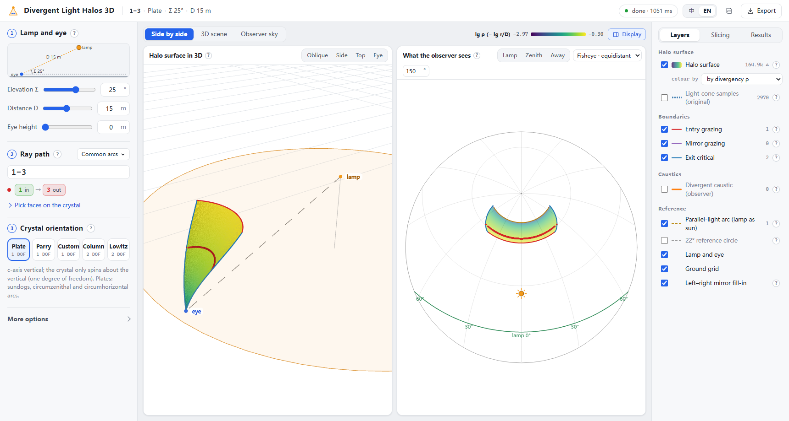

# 发散光晕 3D

[English](README.md) · **中文**

路灯下的冰晕, 三维的. 太阳光从同一个方向来, 所有冰晶看到的太阳都在同一处, 所以晕是天上的一条弧. 路灯就在近处: 每个晶体看到灯的方向都不一样, 能把灯光送进眼睛的晶体在空间里铺成一张**晕面**. 这个工具精确地算出晕面、它的边界和焦散, 既从外面看 (3D), 也按观测者看到的样子画 (天空视图).

**在线使用: <https://galliumboride.github.io/Divergent-Light-Halo/>**

整个工具是一个 HTML 文件. 也可以下载 [`dist/DivergentLightHalo.html`](dist/DivergentLightHalo.html) 双击打开, 任何现代浏览器离线可用.




## 能看到什么

- **晕面**: 灯光沿所选光路能进入眼睛的全部晶体位置. 一自由度画成三角网格, 网格边缘二分到精确边界上; 二自由度每个光锥层画成一条曲线, 第一轮算完后在有曲线的 h 区间里再补层, 曲线族密到能看出曲面. 二自由度也可以画成曲面 (显示设置 → 晕面 → 画法: 层线 / 曲面 / 曲面 + 层线, 默认层线): 相邻两层层线缝成三角形, 即一自由度网格「行 × 列」的做法. 着色可选: 晶体看灯的仰角 h、发散度 ρ = r/D (离眼距离 ÷ 灯距)、按光路、单色. 也可以显示原窗体的光锥采样点.
- **边界**: 晕面在哪里终止 — 光擦着入射面、擦着内部反射面、或在出射面正好处于全反射临界角. 二自由度时还有接缝、转折缝和焦散曲面的尖点脊线.
- **观测者焦散**: 观测者天上最亮的线, 很多晶体的光挤到同一方向; 在空间里是晕面从眼睛看过去的轮廓. 可选画出边界的天空像和无界晕面的渐近圆. 没有焦散时, 结果栏会说明原因 (真的没有 / 在灯后方 / 在眼后方 …).
- **平行光弧**: 把灯换成同一仰角的太阳时这条光路的经典弧, 发散光晕总有一边贴着它.
- **锥切片**: 计算里的一层 — 以仰角 h 离开灯的光锥, 以及锥上的晶体.
- **发散度球壳**: 以眼为心、半径 r 的球面上的晕线 (ρ = r/D, κ = lg ρ), 标出弧的末端、折叠和尖点. ρ → 0 是平行光晕, ρ → ∞ 是反灯点剖面.

两个视图, 可并排也可单看: **3D 场景** (旋转、缩放、平移; 斜看 / 侧面 / 俯视 / 从眼睛看) 与**观测者天空** (直线、四种鱼眼或全景; 拖动转向; 悬停读方位、仰角和距灯角距). 在**工具 → 底图对比**里可以把实拍照片垫在天空视图下面对照 (只在天空视图里; 载入、拖进天空视图或粘贴). 天空随即按照片的长宽比取景, 改窗口大小两者不会错位; 缩放 1 时照片铺满画框 (全天鱼眼照片在 180° 鱼眼视场下像圈正好内切). 照片可以用滑块缩放、平移、旋转, 也可以勾「鼠标拖图」用鼠标 (拖动、滚轮、Shift + 拖动); 「晕透明」调模拟晕本身的透明度, 边界线和网格保持不变. 照片存在浏览器里 (IndexedDB), 刷新后还在.

可以设定:
- **灯与眼**: 灯仰角 (−90° 到 90°)、灯距 (1–300 m)、眼高.
- **光路**: 直接输入 (`3-5; 3-1-5`) 或在晶体上点面; 可多条同时算; 含锥面 13–18 / 23–28.
- **取向**: 板晶、Parry、任意固定 ζ/θ (一自由度); 固定 c 轴倾角的柱晶、固定自旋的 Lowitz (二自由度). 二自由度时可选用哪条平行光曲线做曲面 (焦散或某条边界).
- **更多**: 精度、截断距离、折射率、锥晶顶角.

导出: 当前视图连同标题的 PNG; 全部晕面点 (位置、精确视方向的方位/仰角、距离、h、lg ρ) 与所有边界、焦散、球壳曲线的 CSV. 术语表用大白话解释每个名词. 界面中英文.

## 怎么算的

坐标: Z 朝上, 灯 L = (D cos Σ, 0, D sin Σ), 眼 E = (0, 0, 眼高), 晶体取向 R = Rz(α)·Ry(ζ)·Rz(θ).

- **一自由度 — 光锥法**: 对灯处每个入射仰角 h, 入射方向 û = Rz(ψ)·(−cos h, 0, −sin h); 偏折绕竖直轴对称, 出射方向 = Rz(ψ)·d(α, h). 两焦点条件 (E − L 落在 û 与出射光张成的平面里) 化成 P sin ψ + Q cos ψ = R, 闭式求解; 晶体位置 P = L + t·û, t 由 2×2 方程给出. 再按 α、ψ 扫一遍 (每对二分求 h) 补齐第一遍漏掉的窄带.
- **晕面网格**: 按 h 一行一行地建. 每一行先把 ψ 两支各自的有效 α 区间精确求出来 (有效余量变号处二分到 1e-13; 比取样还细的区间从余量的局部极大里找, 并借相邻行带路). 区间内取点 α = α_a + (α_b − α_a)(1 − cos πτ)/2: 出射临界边旁、ψ 两支折叠处位置按 √(α − α_a) 变化, 而 α − α_a ∝ τ², 位置对 τ 是光滑的 —— √ 奇点被坐标吸收, 不靠加密; 边界节点就是精确根 (两支共用, 接缝处严丝合缝). 相邻两行在三维或天空里离得远、边界弯得厉害、或区间对不上 (出生 / 消失 / 分裂 / 合并) 时插一整行; 区间配对时放宽 20·Δh (细区间一行能挪出比自己还宽的距离). 粗扫之外只要还有区间就继续往外加行, 细楔的尖不会被截掉. 相邻行连成四边形带, 没有 T 形接头, 精确边界点落在网格上误差 ≤ 1 mm. 直线求交用 |û × ê|² 而不是 1 − (û·ê)², 两条光线接近平行 (晶体在远处) 时不丢精度. 比粗扫还细的有效区, 沿每一列、每一行从余量的局部极大里找出来 (低灯下的板晶只存在于略小于 Σ 的一条 h 薄带里, Σ = 2° 时 0.14° 宽); 水平光附近最细行距按 |h| 缩放. 灯与眼等高且光路上全是竖直面 (板晶柱面光路) 时, 只有水平光能连通灯和眼, ψ 成了自由参数: 晕面是灯眼所在水平面上的一块平面区域, 改用 (ψ, β = α − ψ) 建网格, 天空里画成地平线上的弧, 边界线取自精确的区间端点.
- **晕面网格 — 球壳法 (一、二自由度都用它)**: 层是发散度球壳 (以眼为心、半径 r 的球面) 与晕面的交线, 由球壳引擎闭式算出 (一层十几到几十毫秒), 相邻两层在视方向里对应着缝 (`engine/mesh2s.js`). 换掉按 h 分层的原因: 光锥层以灯下的竖直线为轴, 眼睛是这族切面的奇点 —— 光锥过眼睛的那一层 (h = Σ) 前后, 层线贴着眼睛的一截缩成一点, 相邻两层在那里对不上, 而观测者天空正是从这一点看出去的, 三维里几厘米的错连在天空里横跨几十度. 球壳以眼睛为心, 晕面在眼睛处是平行光弧上的锥, 每层截出同一形状的线, 一直到 r → 0 都正则; 同一层上位置与视方向一一对应, 层间的对应、距离、容差全按角度量. 做法:
  - 层线的拓扑 (几条弧、怎么连) 只在临界半径上变 —— 弧的末端点落在边界线上, 所以临界半径就是**已经解出来的三维边界线 / 尖点脊线离眼距离的极值与端点** (边界线交汇处是晕面的尖端, 弧在那里缩成一点), 再加上截断球面 (离灯 maxD) 开始切到曲面和整个切掉的半径 (按各层离灯距离的最大 / 最小值二分出来). 这些半径两侧各放一层, 中间直接收口; 灯所在的球壳 r = D 是另一个锥顶, 同样处理.
  - 相邻两层先配末端点 (视方向互为最近、且明显近于第二近的); 短弧的两个末端点挨得近、按点分不清时, 两条弧整体比 (两端 + 四分点, 正反向取小). 配上的弧一段对一段拉链, 两层配上的尖点是必经的横档; 配不上的段逐点找对面最近的点缝; 还缝不全就二分半径把变化夹紧. 加层的判据: 两层在天空里隔得太远、离灯近处半径隔得太大, 或三维弦高超差 —— 把中间那层球壳真算出来, 量拉链对应点连线中点到它的距离 (曲面几乎贴着球壳走时, 天空间距和半径间距都看不出来). 加层的预算按进了网格的层的顶点数算. 天空里边长超过 5° 的三角形一律不出 —— 宁可留洞, 不连远.
  - 球壳引擎的种子 (二自由度: 1° 网格上 Ĵ 变号; 一自由度闭环: 0.5° 网格上 Φ 变号) 会漏掉比一格还窄的弧 (贴着地平线的一圈、快要缩没的一小段). 补救靠沿半径的延拓: 一层的线比邻层短了一成以上, 或者末端点变少了而中间没有临界半径 (开弧只能在临界半径上消失), 就拿邻层弧上的状态点当种子重算这一层 (引擎加了 `opts.seeds`).
  - 一自由度引擎的末端: 出射临界的末端是相切地到达的, 追踪偶尔从已知末端旁滑过去、贴着篱笆再走一段才停, 停处造一个 "漏端" (记账异常: 漏端 1、末端数为奇), 真正的弧要么没追要么重用一端. 现在弧停在漏端时, 若它途中经过某个已知末端 (w 上 < 2e-3), 就在那里截断收口, 漏端作废.
  - 引擎追小闭环时认不出已经回到起点 (刚出生的环比追踪步长还小, 绕到步数上限): 读入时在第一次回到起点处截断, 当闭环. 缩成一点的弧照留 (晕面的尖端).
  - 校验: `node test/mesh2/shellrun.mjs` (二自由度, 34 个场景) 与 `node test/mesh1/shellrun.mjs` (一自由度, 13 条光路 × 14 组灯位 / 取向) 把网格与另一套引擎 (光锥法) 算出的晕面互相对照, 三维里量一遍、观测者天空里再量一遍: 网格 → 晕面 (三角形里有没有不在晕面上的), 晕面 → 网格 (层线和每条精确边界线有没有没盖到的). 二自由度 28/34 个场景六项全为 0, 一自由度 176/182 个全对 (最慢 83 秒). 剩下的: 4-1-8 Lowitz Σ27 / Σ3.5 的接缝线、3-1-5 Lowitz 入射掠射面各有几米边界线没盖到; 光锥法在 Lowitz 族 ζ → 0 的边上不出层线, 那里的三角形无从比较; 铺满大半个天空的一自由度曲面 (1-3-2) 要几十万个三角形、几十秒, 远处偶有漏盖. 二自由度的光锥层缝合 (`engine/stitch2.js`)、一自由度的 (h, α) 网格 (`engine/mesh1.js`) 留作球壳法超时或出错时的后备; 页面上先画它们, 球壳法的网格算好了就换上, 二自由度的层线也换成球壳轮廓 (按天空间距抽着画).
- **边界 (引擎 v4)**: 每族边界把光链上的一点钉在一个固定圆上, 是一维闭式; 角点、转折、捏合都二分到机器精度.
- **画出来的线**: 所有显示的线 (边界、光锥层、边的延拓轨迹、焦散、球壳弧) 都为显示做了加密: 相邻点在三维、从眼看、从灯看都足够近才停; 曲线终止处二分到精确端点; 只沿同一 ψ 支连线. 天空视图用每个点的精确视方向 (出射光反向), 不用 P − E 相减 — 后者在眼睛附近精度全失. 晕面网格在 GPU 上按所选镜头投影.
- **二自由度**: 每个 h 把灯当作仰角 h 的太阳, 取向平面上所选曲线的每一点闭式映射到光锥上. 焦散 Ĵ = J·√(出射余量) = 0 用数值延拓 (预测–校正, 步长自适应) 追, 不再拼网格追线的结果: 网格只提供种子 (格边变号处, 以及 |J| 的局部极小 —— 比一格还小的闭环). 追线在交叉处直线穿过、在梯度为零的奇点处跨过去、出有效区时二分到边上再解精确端点, 层曲线不再半路停下、原路折回或走成之字. 只有回到起点且走向与出发时相同才算闭合 (细长的 U 形零线回程也会从起点旁擦过, 但方向相反); 踩回自己走过的路就停, 近似交叉处不会绕着一个闭环转个没完. 曲面的边 (末端点轨迹与外缘) 是 (h, 取向) 空间里的曲线, 用伪弧长延拓 (Keller) 追: h 也是未知数, 预测沿切线 (雅可比的零向量) 走一步, 校正在垂直于切线的超平面上解方程. 两个末端点在某个 h 汇合消失 (h 方向的折叠) 时, 边绕过去接着走另一支, 不再停在折叠点 (而且按 h 二分的端点只准到二分步长的平方根). 两个样本之间的点取在垂直于弦的超平面上, 跨折叠也对. 尖点脊线另外每 2° 从追好的焦散线上播种 (曲线的天空像折回处): 末端点引擎只沿从端点出发的弧找尖点, 闭环焦散没有端点, 上面的尖点它找不到, 而层线正是在这些尖点处折回. 掠射类曲面的层线沿掠射曲线自身加密: 中点取在曲线自己坐标 (晶体系单位向量) 的弦上再投回曲线, 而不取 (α, ζ) 的弦中点 —— 曲线在这组坐标里拐得急时, 那样的中点会离开曲面; 整圈的曲线补上回到首样本的那一段. 取向坐标先消去已知的自旋再读, c 轴竖直时也有定义 (Lowitz 模式下这正是可达带边上两支汇合处). 出射掠射面上出射余量直接取精确的 0 来算出射方向, 因为 √(余量) 会把 10⁻¹⁶ 的舍入放大成 10⁻⁸ 的方向噪声. 锥映射的折叠点上两支取平均 (√ 项正负相消), 层线在折叠处接得上. 边界线加密到每一段的中点离弦不超过场景尺度的 10⁻⁴. 追出的焦散若整条是一根坐标线 x_j = c (对称取向上的折叠, 例如柱晶 roll 60°: 取向 c ± δ 映到同一天空点, J 沿整条线为 0), 它的外缘就是这条线走出有效区的地方, 直接解 { x_j = c, 余量 = τ }; 一般式 { Ĵ = 0, 余量 = τ } 在这里病态: 对称取向上入射角等于出射角, 出射余量约为入射余量的平方, Ĵ = J·√(出射余量) 被压了两次. 柱晶 3-1-5-7 的外缘因此从 7 s 降到 2 s 以内 (ζ −90°、Σ 20° 时 25 s → 2 s), 缺口也补上了. 焦散与某条曲线的交点 (末端点) 必须是孤立的: 沿曲线走一小步的 |Ĵ| 不能比离开曲线一小步的小 10⁴ 倍以上. 出射余量整段为 0 的曲线上 (例如柱晶 3-1-5-7, 入射掠射时出射也恰好掠射) Ĵ = J·√(出射余量) 沿整条曲线为 0, 号变只是舍入噪声, 不再当成末端点 —— 以前拿它们延拓, 画出离开曲面悬在半空的边界圈. 补层按第一轮各层之间的三维间距做等分布 (层散开处多补, 挤在一起处不补, 例如 h → ±90° 光锥退化处), 比中位间距的 0.3 倍还挤的层不画. 层都收向灯, 三维间距仍大致与离灯距离成正比; 3D 视图里用补线把它拉平, 同地形图的补充等高线: 相邻两层张开的那一段, 在中间仰角补算一层, 只画这一段, 并逐点淡入 (不透明度 = 局部间距从 1.4 d* 到 2.4 d* 的 smoothstep, d* = 中位间距的 0.75 倍), 线的墨量变化不超过约 15%, 而不是在补线起点处一下子翻倍. 最多补三级, 修剪在 Worker 里做. 天空视图只画整条的层. 画法选「曲面」时, 全部整层 (按 h 排好) 相邻两层缝成三角形, 在 Worker 里做: 行 = 层线 (端点已精确落在边界上), 列 = 沿层线的位置. 一自由度有共同的参数 α 对齐上下两行, 二自由度没有, 就用取向平面 (u, v) 选对应的曲线与支: 相邻两层 h 只差零点几度, 层曲线在 (u, v) 里只挪一点. 锥映射的两支在 (u, v) 里重合 (同一取向两个落点), 每支各取 (u, v) 最近点, 两支之间按三维距离挑; 层线整段落在折叠线 (柱晶 roll 60°) 上时两支是交叠的同一条线段, 光锥穿过眼睛的那层前后层线整个换到另一支, 都靠这一步分开 / 接上. 选定曲线后沿线位置取三维最近点 (局部下降): 取向 → 位置可以剪切得很厉害 (折叠线上 u 差 2° 就从灯旁走到 80 m 外, 相邻两层 u 又整体挪 0.7°, 「同一取向」在两层上隔几十米). 对应好的两段用拉链式三角化缝起来: 拉链必须经过逐点找好的对应 (横档), 横档之间才按较短的对角线走 —— 只贪心的话, 两层都是 U 形环、外层大一圈时 (外层尖端那一段都对应内层的尖点), 会从外层一个点扇形连到内层环的另一臂, 盖住的是环的里面, 两环之间反而空着. 三角形边长的上限跟着这一段自己的对应距离走; 路标配对与帽的端点是拓扑上确定的对应, 不受「最大连接距离」这道保险限制 (边界线几乎顺着层线走时, 层线端点离邻层可以有八九米, 按距离丢掉就是边界线旁一道楔形缺口); 层线斜着停在同一条边界上留下的楔形用扇形补上, 层线穿过灯 (捏合点) 处扇形收到灯点. 精确边界线、转折缝、尖点脊线、外缘 (特征线) 必须是网格的边: 层线落在特征线上的顶点 (端点、折回点、折角) 是路标, 相邻两层沿同一条特征线挨着的路标强制对应, 缝合在路标处断成两段 (两侧各缝各的), 两个路标的连线成了两段共用的边; 两个路标之间特征线弯得厉害时 (远处边界线几乎顺着层线走, 相邻两层的路标沿线隔十几米) 把线上的点插进网格. 不加这个约束, 层线在尖点脊线上折回处两臂在三维里重合, 贪心拉链会把一层的尖点连到下一层尖点前面的点上、再从回程臂扇回来, 脊线旁留一排底边在脊线上的三角形缺口; 斜穿层线的折痕则被三角形抄近路. 法向按折痕角 (60°) 逐角算, 折叠处共用顶点的两张面各用各的. 相邻两层之间 h 的等值线拓扑变了的地方拉链对不上, 分三步补: (1) 帽 —— 一层有两条线的端点落在同一条边界线上, 沿边界线挨着, 这段边界线的 h 都在两层之间 (边界线在两层之间鼓出去一段, 一条层线在这里断成两截, 邻层的线从旁边整条过去): 缝合之前先把这段边界线与邻层对着的那一段直接拉链缝上, 两条边界线在两层之间相交 (过交汇点) 的也算; (2) 同层两支首尾相接的曲线接成一条 (锥映射的两支在折叠线上相接, 分开缝的话沿两支的交线留一排细缝, 一圈闭合层线也合不成环), 同层整条重合的重复曲线只留一条; (3) 补空当 (切片轮廓重建的标准第二步, Barequet–Sharir): 开口边 (只属于一个三角形的边) 里不沿特征线的是缺陷边, 缺陷边加上还没贴上网格的特征线段连成图, 过每条缺陷边找最短的环 (限在相邻几层之内), 环就是空当的边界多边形, 按最小面积三角化 (区间动态规划) 补上 —— 最里一圈闭合层线之内的帽、首末层之外到边界线交汇点的一块、拉链留下的零碎都这样补; 尖点脊线的尽头是悬空的端点, 多边形沿脊线切成两半, 两张面各补到脊线. 补之前查: 不使任何边超过两个三角形、不与已有三角形重复、不折回到已有三角形上 (那是一块孤立小片的外圈, 不是洞). `node test/mesh2/run.mjs` 在 34 个场景 (不同光路 / 取向 / 灯仰角 / 曲面类型) 上做两项检查: 「特征线上相邻两层的路标是否连成了网格的边」—— 19,211 处里缺顶点 0、缺边 5、边界线偏离网格 2 (加特征线约束之前约 989 / 744 / 1059); 「网格的开口边是否都落在特征线上」—— 不在特征线上的开口边总长 873 m (量法含页面那一轮补层; 同一量法下上一版 1296 m, 没有补空当之前约 2850 m). 补空当的环可以经过灯 / 眼这两个捏合点 (各层层线的公共端点, 在这里起止的边界线也以它为端点) —— 最末一层之外的帽常常一头收在灯上, 光锥过眼睛那一层前后两层之间的透镜形窄带两头收在灯和眼上; 层线上两个三角形都在同一侧 (重叠) 而另一侧空着的边、一个三角形也没有的层线边, 也都算空当的边界. 同一类缺口会随灯仰角才暴露 (柱晶 4-1-8: Σ 3.5° 时端点离邻层刚好在距离上限之内, Σ 1° 时超了), 所以套件里同一光路放了 Σ 0.5°–45° 的一串. 对不上的相邻两层 (曲线在两层之间出生、消亡或换到对称的另一组取向) 在中间补算一层再缝一次. 下一层在那里整段没有曲线 (连 (u, v) 候选都没有) 时隔一两层再找, 三维距离按跨过的 h 收紧 (0.05 D + 10 r Δh), 免得跨过真的空洞. 灯后方沿灯–眼连线延长线的那段层线以前在 h ≈ −Σ 前后会连着几层缺失 (晕面在灯后留一道几十米长的缝), 现在在层线计算里补上了: 晶体把光几乎原路折回 (平行光的天空方向经过反日点; 经过太阳方向时同理) 时, 灯光线与出射光线平行, 锥映射的落点沿灯眼连线跑到无穷远 —— 这一段从灯旁一直伸到最大距离, 却只占曲线参数上极窄的一段 (天空方向离极点 δ 处落点在约 D/δ 远), h → ∓Σ 时越来越窄, 相邻两个取样点都落在它外面时两头都是「无效」, 加密和端点二分看不见它. 光锥离灯眼连线 6° 以内的层里, 每条曲线找出天空方向最接近太阳 / 反日方向的位置 (三分), 朝两侧各插一串逐次减半的样本, 再窄的窗口里也落进几个. 天空视图里张角超过 25° 的三角形在球面上细分 (最多 4 层; 灯旁收拢的扇形本来就大), 超过 60° 的多半是连错的, 不画; 这样不会被直线投影拉成穿过天空的大片. 已知局限: 剩下的开口边主要在三处 —— 光锥穿过眼睛 (h ≈ Σ) 的那一层紧贴眼睛的一小圈 (晕面在这里穿过观测者, 捏合半径 0.02 D 之内不补; 从眼睛看是灯两侧各一个小楔形)、远处只剩单条的长边 (相邻两层在几十米外隔得很开)、两张面在三维里重合处 (两臂抢邻层的同一臂, 这里容许三角形重叠而不留缺口); 试过「每条边至多两个三角形」的严格流形约束, 重合处反而留一排缺口, 没有采用; Lowitz 晶入射掠射面在 h ≈ 0 附近天空里还有细缝 (闭式掠射曲线取样对宽度 ∝ |sin h| 的那一段分辨不够, 层线也一样).
- **观测者焦散**: χ(ξ) = det(ξ, F(ξ), DF⁻¹(ŵ×F) − ŵ×ξ) = 0 是一条与灯无关的曲线; 灯只负责在锥上配对方位角并决定哪些看得见. 沿零线逐点解出来的点按连续性串成线; 一段接不上下一个样本时 (两支 α 在重根处汇合, 或走出可见区 / 超出最大距离), 在两个样本之间沿零线二分到最后一个接得上的点 —— 重根旁位置随参数呈 √ 变化, 相邻样本可以隔好几米, 不补的话两支在汇合点两侧各差一截, 焦散线中间空一段 (二自由度以前没有这一步: 柱晶 4-1-8 Σ 30° 空了 8 m). 段内相邻两点隔得远时在零线上取中点加密.
- **发散度球壳 —— 尖点**: 二自由度焦散在一层壳上的尖点 (紫色星号) 改成在延拓参数里找: 天球像的速度 (天球弦长 ÷ 状态空间步长) 降到局部极小、且前后几步的方向反转. 原来只看相邻两段弦是否反向, 尖点恰好落在取样点上才认得出, 对称的一对常常只认出一个; 和三维尖点脊线穿过各层球壳的次数对照, 原来只找到 34/62、26/70、14/43, 现在 62/62、70/70、44/43.
- **发散度球壳**: 一层壳上的晕线是晶体系太阳球上同一个二次型 Φ_ρ(w) = (S + ρe_z)² − 2ρ p u_z (S + ρe_z) + (ρ² − 1) u_z² 的零点集, 被光路的边界剪成弧, 从末端点出发延拓.

全程不用随机光线追踪采样来估计.

`src/engine/` 里的引擎是作者 C# 引擎的逐句 JavaScript 移植 (一个私有 WinForms 模拟器的「发散光晕3D」窗体、发散度球壳引擎、观测者焦散引擎、光点法末端点引擎), 与 C# 原版在 17 + 56 + 44 个用例上逐点对账 (关掉显示加密时): 点、曲线、末端和各种标记的个数完全一致; 坐标差在舍入量级 (剩下的 1e-13 … 1e-6 m 来自 .NET 与 V8 的 sin/cos/atan2 末位不同).

## 从源码构建

```bash
npm install
```

```bash
npm run build
```

生成 `dist/DivergentLightHalo.html` (单文件, 内联 CSS、JS、Worker 和 three.js), 并复制一份到 `docs/index.html` 供 GitHub Pages 使用. `npm run watch` 改动即重建; `npm run serve` 在 <http://127.0.0.1:5179> 预览.

相关: [光点法边界追踪](https://github.com/GalliumBoride/Light-Point-Trace) (平行光, 精确弧线与末端点).

## 许可

[MIT](LICENSE)
