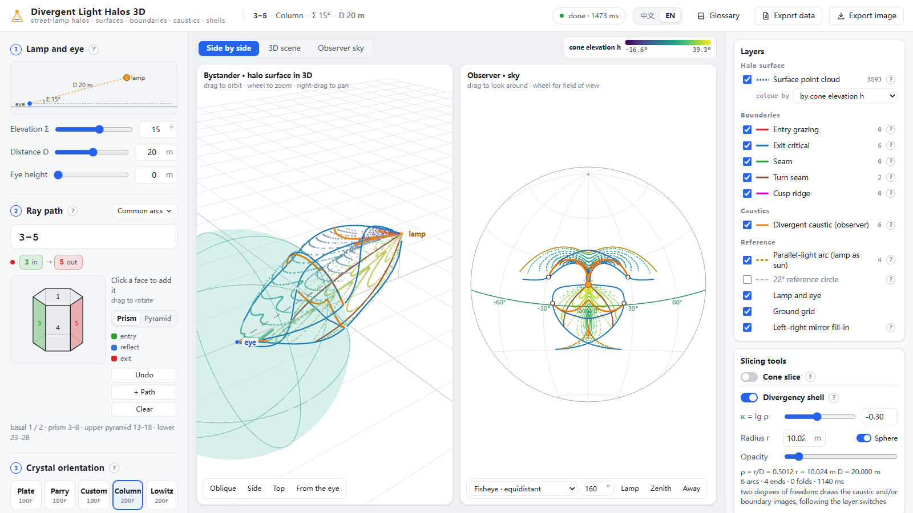

# 发散光晕 3D

[English](README.md) · **中文**

路灯下的冰晕, 三维的. 太阳光从同一个方向来, 所有冰晶看到的太阳都在同一处, 所以晕是天上的一条弧. 路灯就在近处: 每个晶体看到灯的方向都不一样, 能把灯光送进眼睛的晶体在空间里铺成一张**晕面**. 这个工具精确地算出晕面、它的边界和焦散, 既从外面看 (3D), 也按观测者看到的样子画 (天空视图).

**在线使用: <https://galliumboride.github.io/Divergent-Light-Halo/>**

整个工具是一个 HTML 文件. 也可以下载 [`dist/DivergentLightHalo.html`](dist/DivergentLightHalo.html) 双击打开, 任何现代浏览器离线可用.




## 能看到什么

- **晕面**: 灯光沿所选光路能进入眼睛的全部晶体位置. 一自由度画成三角网格, 网格边缘二分到精确边界上; 二自由度每个光锥层画成一条曲线, 第一轮算完后在有曲线的 h 区间里再补层, 曲线族密到能看出曲面. 二自由度也可以画成曲面 (显示设置 → 晕面 → 画法: 层线 / 曲面 / 曲面 + 层线, 默认层线): 相邻两层层线缝成三角形, 即一自由度网格「行 × 列」的做法. 着色可选: 晶体看灯的仰角 h、发散度 ρ = r/D (离眼距离 ÷ 灯距)、按光路、单色. 也可以显示原窗体的光锥采样点.
- **边界**: 晕面在哪里终止 — 光擦着入射面、擦着内部反射面、或在出射面正好处于全反射临界角. 二自由度时还有接缝、转折缝和焦散曲面的尖点脊线.
- **观测者焦散**: 观测者天上最亮的线, 很多晶体的光挤到同一方向; 在空间里是晕面从眼睛看过去的轮廓. 可选画出边界的天空像和无界晕面的渐近圆. 没有焦散时, 结果栏会说明原因 (真的没有 / 在灯后方 / 在眼后方 …).
- **平行光弧**: 把灯换成同一仰角的太阳时这条光路的经典弧, 发散光晕总有一边贴着它.
- **锥切片**: 计算里的一层 — 以仰角 h 离开灯的光锥, 以及锥上的晶体.
- **发散度球壳**: 以眼为心、半径 r 的球面上的晕线 (ρ = r/D, κ = lg ρ), 标出弧的末端、折叠和尖点. ρ → 0 是平行光晕, ρ → ∞ 是反灯点剖面.

两个视图, 可并排也可单看: **3D 场景** (旋转、缩放、平移; 斜看 / 侧面 / 俯视 / 从眼睛看) 与**观测者天空** (直线、四种鱼眼或全景; 拖动转向; 悬停读方位、仰角和距灯角距). 在**工具 → 底图对比**里可以把实拍照片垫在天空视图下面对照 (只在天空视图里; 载入、拖进天空视图或粘贴). 天空随即按照片的长宽比取景, 改窗口大小两者不会错位; 缩放 1 时照片铺满画框 (全天鱼眼照片在 180° 鱼眼视场下像圈正好内切). 照片可以用滑块缩放、平移、旋转, 也可以勾「鼠标拖图」用鼠标 (拖动、滚轮、Shift + 拖动); 「晕透明」调模拟晕本身的透明度, 边界线和网格保持不变. 照片存在浏览器里 (IndexedDB), 刷新后还在.

可以设定:
- **灯与眼**: 灯仰角 (−90° 到 90°)、灯距 (1–300 m)、眼高.
- **光路**: 直接输入 (`3-5; 3-1-5`) 或在晶体上点面; 可多条同时算; 含锥面 13–18 / 23–28.
- **取向**: 板晶、Parry、任意固定 ζ/θ (一自由度); 固定 c 轴倾角的柱晶、固定自旋的 Lowitz (二自由度). 二自由度时可选用哪条平行光曲线做曲面 (焦散或某条边界).
- **更多**: 精度、截断距离、折射率、锥晶顶角.

导出: 当前视图连同标题的 PNG; 全部晕面点 (位置、精确视方向的方位/仰角、距离、h、lg ρ) 与所有边界、焦散、球壳曲线的 CSV. 术语表用大白话解释每个名词. 界面中英文.

## 怎么算的

坐标: Z 朝上, 灯 L = (D cos Σ, 0, D sin Σ), 眼 E = (0, 0, 眼高), 晶体取向 R = Rz(α)·Ry(ζ)·Rz(θ).

- **一自由度 — 光锥法**: 对灯处每个入射仰角 h, 入射方向 û = Rz(ψ)·(−cos h, 0, −sin h); 偏折绕竖直轴对称, 出射方向 = Rz(ψ)·d(α, h). 两焦点条件 (E − L 落在 û 与出射光张成的平面里) 化成 P sin ψ + Q cos ψ = R, 闭式求解; 晶体位置 P = L + t·û, t 由 2×2 方程给出. 再按 α、ψ 扫一遍 (每对二分求 h) 补齐第一遍漏掉的窄带.
- **晕面网格**: 按 h 一行一行地建. 每一行先把 ψ 两支各自的有效 α 区间精确求出来 (有效余量变号处二分到 1e-13; 比取样还细的区间从余量的局部极大里找, 并借相邻行带路). 区间内取点 α = α_a + (α_b − α_a)(1 − cos πτ)/2: 出射临界边旁、ψ 两支折叠处位置按 √(α − α_a) 变化, 而 α − α_a ∝ τ², 位置对 τ 是光滑的 —— √ 奇点被坐标吸收, 不靠加密; 边界节点就是精确根 (两支共用, 接缝处严丝合缝). 相邻两行在三维或天空里离得远、边界弯得厉害、或区间对不上 (出生 / 消失 / 分裂 / 合并) 时插一整行; 区间配对时放宽 20·Δh (细区间一行能挪出比自己还宽的距离). 粗扫之外只要还有区间就继续往外加行, 细楔的尖不会被截掉. 相邻行连成四边形带, 没有 T 形接头, 精确边界点落在网格上误差 ≤ 1 mm. 直线求交用 |û × ê|² 而不是 1 − (û·ê)², 两条光线接近平行 (晶体在远处) 时不丢精度. 比粗扫还细的有效区, 沿每一列、每一行从余量的局部极大里找出来 (低灯下的板晶只存在于略小于 Σ 的一条 h 薄带里, Σ = 2° 时 0.14° 宽); 水平光附近最细行距按 |h| 缩放. 灯与眼等高且光路上全是竖直面 (板晶柱面光路) 时, 只有水平光能连通灯和眼, ψ 成了自由参数: 晕面是灯眼所在水平面上的一块平面区域, 改用 (ψ, β = α − ψ) 建网格, 天空里画成地平线上的弧, 边界线取自精确的区间端点.
- **晕面网格 — 球壳法 (一、二自由度都用它, `engine/shellmesh.js`)**: 要解决的是把晕面铺成三角形, 边界与折痕精确地是网格的边, 相邻两层的对应由参数决定. 工具是以眼为心的发散度球壳: 球壳截晕面得到一层轮廓, 由球壳引擎闭式 + Newton 算出, 每层直接算. 不用按 h 分层的原因: 光锥层以灯下的竖直线为轴, 眼睛是这族切面的奇点, 而观测者天空正是从这一点看出去的; 球壳以眼睛为心, 晕面在眼睛处是平行光弧上的锥, 每层截出同一形状的线, 一直到 r → 0 都正则. 步骤:
  1. **层**: ln r 上均匀取层; 临界半径 (三维边界线离眼距离的极值与端点 —— 层线的拓扑只在这里变) 两侧、灯所在的球壳两侧各加一层.
  2. **特殊点与特殊线 (骨架)**: 每层轮廓上找特殊点 —— 末端点 (开弧两端, 碰到另一条边界)、折点 (天空里掉头处: 前后各沿线走一小段, 两段弦夹角超过 120°; 离眼远了折痕常变成圆角 —— 零点一到零点几度的半径, 小段不够长就看不出 —— 所以这一段从 1/4 天空步长起加倍, 到一个天空步长为止, 夹角超过 100° 也算; 大的那几档只用在比它长 8 倍 (闭环 16 倍) 以上的弧上, 灯旁一两度的小圈不算; 闭环上跨过起点的折角不拆成两半)、焦点 (整段映到一点)、截断点 (截断球面切口). 引擎直接算出的三维边界线 (二自由度: 光锥法边界引擎的入射掠射 / 出射临界 / 接缝 / 转折缝 / 尖点脊线 / 外缘; 一自由度: 边界引擎 v4) 也是骨架的一部分: 每个末端点贴上 "落在哪条线、线上哪个位置" 的标签 (同一条线常有几份重合的副本, 有共同的线就算同一条; 容差按 r 的比例, 因为所有边界线都在眼睛处汇合). 相邻两层的特殊点按类型和标签连起来 (有标签的只连同一条线上相邻的交点, 没标签的按三维最近且无歧义), 得到特殊线: 边界线、折叠线、焦线.
  3. **按参数铺三角形**: 每层轮廓在 "两层都还在的特殊线" 处切段; 两端连着同一对特殊线的段互相对应, 按段内弧长比例直接拉链成三角形带. 每层的顶点固定 (全部特殊点 + 段内按点距均匀取), 上下两条带共用; 特殊点是顶点, 特殊线是边; 两层之间沿三维边界线插入它的点 (网格的边就是精确边界线). 不再按天空最近点去猜对应.
  4. **加密**: 有段或特殊点对不上 (这两层之间有特殊线出生 / 消失 = 拓扑在变) → 二分夹到相对 5e-4; 对应点在天空里隔得超过 3 倍点距 (至少 1.2°)、边界线在两层之间弯出弦高、三层对应点的径向弯曲超过 1 cm + 0.1% r、灯旁半径步太大 → 中间加一层. 点距按平行光弧 (r → 0 时的层线) 的天空长度与顶点预算定, 0.35°–0.8°.
  5. **拓扑变化处** (相邻两层几乎重合, 或临界半径两侧那一对): 对不上的段, 小的收口, 其余逐点就近缝; 灯两侧那一对层收到灯上 (晕面在灯上是锥顶).
  - 引擎给的一条轮廓有时分成几段 (边界像在 σ 的一支没了、另一支接着走的地方断开, 两段端点重合): 先首尾并接成一条再找特殊点 —— 这种接头不是末端点, 不落在任何边界线上.
  - 折叠线: 例如 3-5 Lowitz Σ15.5 的入射掠射面, 每层轮廓都有一对尖锐的折点, 连成从眼到灯的一条折叠线, 光锥法边界引擎没有这条线 (离它最近的边界线 0.3–3 m). 现在折叠线按尖点脊线的颜色画出 (随它的开关), 网格以它为边. 下面那一对折痕在眼旁尖到取样点距以下 (r = 3 m 处 0.01° 的窗口里转 128°), 往外越来越圆 (r = 10 m 处 0.03° 里只转 40°, 0.3° 里转 116°), 一直到灯前 0.4 m 轮廓的尾巴缩没为止; 只用固定的小窗口时折叠线只画到 7.9 m (一半), 多尺度以后画到 14.6 m (灯距 15 m). 一簇里在最小尺度上触发的点分成几串时 (相隔不到一个大窗口的两个折点, 大窗口下连成一簇) 每串一个折点 —— 3-5 Lowitz Σ10.5 出射临界面上两对折叠线在灯前 1 m 里挨得只差零点几度, 原来某些层并成一个折点, 线断成几截. 折点的形状不都一样: 有的是尖点 (眼旁, 几个取样点里就折回), 有的是发夹弯 (出射临界面: 0.003° 里只转 10°, 1° 里转 157–176° —— 轮廓确实掉头, 只是折痕是圆的, 半径约 0.05–0.1°), 有的是折角 (3-5 入射面离眼远处: 转 115–136° 不到掉头); 都当折叠线. 不画的: 径向延续不到所在半径 15% 的短链 (两头碰到分段边界的除外) —— 多是球壳与晕面相切 (鞍点) 处的假折点: 两条交叉的轮廓在切点重新连成 )(, 刚分开时双曲线顶点尖得像尖点 (各尺度都转 175°), 半径稍一变就钝了, 晕面本身在那里是光滑的 (3-4-5 Lowitz Σ10.5 入射面 r 3.16–3.54 m 那一对, 天空里横扫 30°). 它们仍是网格顶点, 只是不当成折痕画出来.
  - 穹顶收口: 晕面离眼最远 (或最近) 处与球壳只在一点相切时, 最后一层只剩一个闭环, 下一层什么都没有 —— 闭环收成扇形 (原来闭环超过 1° 就不收, 自缝又不缝单个闭环的对边: 3-5-6-8 Parry Σ34.5 在 r≈14.43 m 留一个五边形的洞). 同时消失的不止一个闭环 (一里一外, 是一圈折回) 仍按同层自缝.
  - 一自由度引擎的两种假弧, 输出时丢掉: 晶体系里几乎不动 (w 全程 < 1e-4) 却在天上拉出 0.5° 以上的弧 —— 同一个取向不会铺成一条天空弧, 是追踪在 Φ 退化的方向上空走 (晕面快到最远处、有效区缩成一点时, 3-1-5 Parry Σ34.5 r≈16.73: 3 个点的弧跨 17° 和 125°, 网格里缝出一排紫色尖刺); 天上累计超过 720° 的失控弧 (同一处, 8 万个点). 收到已知末端上的那一步若在天上超过 2° 也不收.
  - 折回带: 晕面在两层之间到了离眼最远 (或最近) 处折回 —— 一层上的两条轮廓 (或一条闭环的两侧) 在下一层之前汇合消失, 下一层什么都没有, 中间那条带子以前留空 (3-5-6-8 Lowitz Σ10.5 焦散: 晕面在 r = 17.32 m 沿一整圈与球壳相切, 天空里灯外 25° 一整圈白缝, 三维里一道缺口). 现在同一层里对不上、对面也没有可缝的点, 与同层别的轮廓或同一条轮廓沿线隔得远的一侧缝上 (带子在这一层的球面上, 离真曲面不超过两层的半径差).
  - 焦线: 有的光路在一层球壳上有一整段焦散映到天上同一点 (σ 不变、天空直径 ~1e-6°; 如 3-5 column ζ−90 的一支, column 3-4-5 ζ−90 整个焦散都是). 一整条取向曲线上的光射向同一点 —— 焦点, 比焦散还亮; 各层的焦点连成三维里的一条焦线, 按晕面的颜色画粗一些. 与光锥法边界引擎独立算出的三维线重合到 1e-5 m (边界引擎把它当成了尖点脊线 / 接缝线).
  - 焦散整段贴着边界: Lowitz 3-4-5 的 Ĵ = 0 有一支整段与入射掠射边界重合, 有效裕度只剩 Newton 误差 (±5e-8). 有效区要求裕度 ≥ 1e-6: 重合的那支不算内部, 真焦散撞到边界的末端只往里挪 1e-6.
  - 一自由度引擎的末端: 出射临界的末端是相切地到达的, 追踪偶尔从已知末端旁滑过去、停在一个 "漏端" 上. 现在比的是已知末端到弧上每一小段 (相邻两点连线) 的距离 (< 2e-3), 碰到就在那里截断收口; 尖端旁的小弧只有几个点, 一步就跨过了末端 (3-5 Parry Σ10 r≈6.15: 真弧 0.04° 之外原来多出 5° 长、4 个点的假弧). 停在离已知末端很近处 (< 5e-3) 校正失败的弧收在这个末端上.
  - 页面: 一条光路按 ln r 切成与 Worker 数相同的段并行 (段界避开临界半径与灯, 交界那层两段都算, 网格在那里接上), 回来一段画一段. 二自由度先算三维边界线与外缘 (它们是骨架), 再算网格; 不算光锥层 (只在球壳法没成时补算, 给光锥层缝合当后备). 一自由度的光锥采样点只在打开 "光锥采样点" 时才算, (h, α) 网格只在灯眼等高 (可能平面退化) 或球壳法没成时才算. 层线按累计天空间距等分画约 70 条.
  - 贴边 —— 两层之间, 边界线也是轮廓的一部分: 同一层上两个没有延续到对面一层的末端点, 若都在三维边界线上、沿线从一个走到另一个的那一段整个夹在这两层的半径之间, 那段线就是晕面在这两层之间的边, 把它两头的弧接成一条. 几种拓扑变化是同一个道理: 一条弧的两端互相接上 (弧从线上出生 / 缩回线上消失 —— 弧与那段线围成的月牙沿线上的点铺满; 或闭环碰到线后张开), 两条弧的末端接上 (在线离眼最远 / 最近处合并 / 分开). 接起来的段照常与对面一层的段对应, 顶点 = 各弧自己的顶点 + 线上的点, 网格的边就是精确边界线. 两层的末端点在同一条线上、沿线跑得却比层距快时 (晕面在这里几乎与球壳相切; 远处截断球面的切口也一样), 长的那一层多出来的一头对着两层之间的那段边界, 剩下的才对着短的那一层. 没有线可走的 (截断球面刚切进闭环; 对称面上左右两半各差千分之几度没合上) 挨得近的直接连.
  - 极点线: 二自由度曲面有一类真边界只在灯光仰角 h 取一个值时存在. 灯光恰好沿取向族的第二个转轴射来时 (Lowitz: 转轴水平, h = 0, 即过灯的水平面), 绕这根轴转不改变晶体系里的入射方向 —— 一整圈取向对着同一个入射方向. 若这个方向正好是两条边界横截相交的角点 (Lowitz θ = 0 的 3-1-5-8: 入射面 3 的掠射线与底面的接缝线都过 a 轴方向), 边界像在这里结束, 末端不是一个点而是一整条空间曲线. 光锥法的边界引擎按 h 延拓, 追不出一条只在一个 h 上存在的线; 现在按闭式直接给 (每个转角: 一条直线与一个固定椭圆 σ² + 2pσρ + ρ² = 1 的交点), 与球壳引擎逐层二分出来的角点末端对到 2e-3° 以内 (`node test/audit/pole.mjs`). 原来这条边没有边界线可贴, 网格也不知道这里有临界半径: 3-1-5-8 Lowitz Σ87.5 入射掠射面整圈都在 r 15.797–15.812 m 之内的那条边、Σ34.5 与 Σ10.5 接缝面上几十米长的边都是这样. 两条边界整条重合的 (3-4-5: 入射掠射 ≡ 出射临界) 不算角点.
  - 鞍点: 晕面内部的拓扑变化 (闭环掐成两个 / 两条弧交换端点 / 弧上掐下一个闭环; 灯是锥顶, 掐断点也常落在灯上). 每层上挨得最近的那一对不相邻的点是双曲线的两个顶点, 两层的四个点围着鞍点; 各段在这些点处切开, 切出来的小段两两对应成 "臂" 照常拉链, 中间的四边形补两个三角形 —— 不重叠、不留洞 (原来的就近缝两个方向各缝一遍, 互相重叠, 中间还剩一个洞). 晕面的一道折回脊斜穿过两层时, 一层上面对面挨着的两截互相拉链. 认不出来的才退回就近缝.
  - 自检与补洞: 每一段网格出来后把三角形的边数一遍. 只属于一个三角形的边应该都是晕面的真边界 (两端都是末端点 / 截断点 / 边界线上的点 / 灯, 或都在这一段最里、最外一层上); 其余是缺口. 围成小闭环的补上 (最小面积三角化), 补不了的按天空里的总长报出来 —— 结果面板的 "网格自检" 一行.
  - 段间不留缝: 交界那一层相邻两段各算一次. 现在两段都不带相邻层的种子算 (同一个确定的计算, 轮廓逐点相同), 顶点按同一个点距取 (段内的点距可以按各段的预算放大, 交界层不跟着变), 半径取同一个数 —— 两段在交界层上的顶点逐位相同. 原来各段按自己的预算放大点距, 交界层两侧的三角形边对不上, 屏幕上是一圈细缝.
  - 不盲信单独一层: 轮廓总长随半径连续. 夹在两层 (半径差 < 2%) 之间的一层若总长跳出两邻层的范围、放进去以后两侧又都对不上, 多半是引擎在这一层漏了 (或重了) 一条轮廓 —— 加密种子重算, 把半径挪一挪重算, 都不行就不要这一层. 引擎一侧, 追踪每一步查 "自然定向" (曲线方程的零向量按行列式取的方向, 沿光滑曲线连续): 一步落到近鞍点对面那一支上时它反号, 步长减半重走 (减到下限还反号是真的相交, 照原步长走) —— 掐断点旁的层不再时有时无 (3-1-5 Parry Σ87.5 满天的小洞).
  - 层数与用时有上限: 层数上限随初始层数 (一段只有七八层初始层时不许加到几百层 —— 那是相邻层反复对不上在空转); 加密完再按实际层数把段内点距放大到预算以内, 只放大点距、不放大 "够得着" 的范围 (否则就近缝会把天上隔着 20° 的两处缝到一起). 3-1-5-8 Lowitz Σ87.5 入射掠射面原来有一段算 43 秒、共 175 万个三角形 (页面停在 "11/12 段"), 现在全部 2 秒、8 万个.
  - 降自由度的光路: 各条边界曲线的像互相重叠着铺满同一条轮廓 (每一点至少被盖两次), 每条像的末端多半落在别的像中间, 不是真末端. 现在先并成不重叠的几条 (长的先留, 后面的只留没被盖住的部分, 从已留弧的端点接着走), 接头不当特殊点; 首尾差不到半个点距的弧当闭环 (8 字形的闭环从叉点断开时, 两层可能断在不同的那一次经过上). 柱晶 3-5-6-8 Σ20.5: 26 万个三角形、27 秒 → 10 万个、5 秒, 天空里 333° 的细缝没有了.
  - 贴边审计: `node test/audit/run.mjs` 走页面的整条管线 (`worker.js` 原样: 边界线 → 按半径分段 → 各段网格 → 拼起来), 把各段的三角形按顶点位置焊在一起, 逐条查开口边是不是在精确边界线上 / 截断球面上 / 最里最外一层 / 灯旁, 再反过来查每条边界线离网格多远. 上面的回归套件只测单段网格的覆盖, 测不到段间的缝, 也不看边贴没贴上 —— 所以以前套件全过而页面上有缝. `test/audit/scenes.txt` 里 23 个出过问题的场景: 缺口合计从 1816° (天空里的总长) 降到 52°, 段间缝从最多 1204° 到全为 0; 15 个场景完全合格. 剩下的: 3-5-6-8 Lowitz Σ10.5 焦散有 29° 缺口, 另有 436 m 边界线不在网格上 (线的真假还没查清); 柱晶 3-5-6-8 Σ34.5 晕面最远的尖上 5°; 转折缝在灯旁离网格 4 cm (容差 3.5 cm); 其余是不到 2° 的零宽缝.
  - 校验: `node test/mesh2/shellrun.mjs` (二自由度, 38 个场景) 与 `node test/mesh1/shellrun.mjs` (一自由度, 13 条光路 × 14 组灯位 / 取向) 把网格与另一套引擎 (光锥法) 算出的晕面互相对照, 三维里量一遍、观测者天空里再量一遍: 网格 → 晕面 (三角形里有没有不在晕面上的), 晕面 → 网格 (层线和每条精确边界线有没有没盖到的). 二自由度 31/38 个场景六项全为 0, 一自由度 182/182 个全对 (单线程最慢 21 秒). 剩下的: 4-1-8 Lowitz Σ27 / Σ3.5 的接缝线有几米没盖到, 4-1-8 Lowitz Σ10 眼旁的边界线在天空里漏 8° (这两处以前就有); 1-3 column Σ52 眼旁的外缘 / 出射临界线在天空里漏 24° (三维 0.5 m), 3-1-5 Lowitz 焦散有 2.8 m 边界线离网格超过 10 cm; Lowitz 3-4-5 的 4 条 "接缝线" 从眼睛连到灯, 那里两套引擎都没有曲面 (边界引擎在这个退化场景里的伪线); 只有焦线的光路 (column 3-4-5) 没有三角形, 网格校验不适用; 光锥法在 Lowitz 族 ζ → 0 的边上不出层线, 那里的三角形无从比较.
- **边界 (引擎 v4)**: 每族边界把光链上的一点钉在一个固定圆上, 是一维闭式; 角点、转折、捏合都二分到机器精度.
- **画出来的线**: 所有显示的线 (边界、光锥层、边的延拓轨迹、焦散、球壳弧) 都为显示做了加密: 相邻点在三维、从眼看、从灯看都足够近才停; 曲线终止处二分到精确端点; 只沿同一 ψ 支连线. 天空视图用每个点的精确视方向 (出射光反向), 不用 P − E 相减 — 后者在眼睛附近精度全失. 晕面网格在 GPU 上按所选镜头投影.
- **二自由度**: 每个 h 把灯当作仰角 h 的太阳, 取向平面上所选曲线的每一点闭式映射到光锥上. 焦散 Ĵ = J·√(出射余量) = 0 用数值延拓 (预测–校正, 步长自适应) 追, 不再拼网格追线的结果: 网格只提供种子 (格边变号处, 以及 |J| 的局部极小 —— 比一格还小的闭环). 追线在交叉处直线穿过、在梯度为零的奇点处跨过去、出有效区时二分到边上再解精确端点, 层曲线不再半路停下、原路折回或走成之字. 只有回到起点且走向与出发时相同才算闭合 (细长的 U 形零线回程也会从起点旁擦过, 但方向相反); 踩回自己走过的路就停, 近似交叉处不会绕着一个闭环转个没完. 曲面的边 (末端点轨迹与外缘) 是 (h, 取向) 空间里的曲线, 用伪弧长延拓 (Keller) 追: h 也是未知数, 预测沿切线 (雅可比的零向量) 走一步, 校正在垂直于切线的超平面上解方程. 两个末端点在某个 h 汇合消失 (h 方向的折叠) 时, 边绕过去接着走另一支, 不再停在折叠点 (而且按 h 二分的端点只准到二分步长的平方根). 两个样本之间的点取在垂直于弦的超平面上, 跨折叠也对. 尖点脊线另外每 2° 从追好的焦散线上播种 (曲线的天空像折回处): 末端点引擎只沿从端点出发的弧找尖点, 闭环焦散没有端点, 上面的尖点它找不到, 而层线正是在这些尖点处折回. 掠射类曲面的层线沿掠射曲线自身加密: 中点取在曲线自己坐标 (晶体系单位向量) 的弦上再投回曲线, 而不取 (α, ζ) 的弦中点 —— 曲线在这组坐标里拐得急时, 那样的中点会离开曲面; 整圈的曲线补上回到首样本的那一段. 取向坐标先消去已知的自旋再读, c 轴竖直时也有定义 (Lowitz 模式下这正是可达带边上两支汇合处). 出射掠射面上出射余量直接取精确的 0 来算出射方向, 因为 √(余量) 会把 10⁻¹⁶ 的舍入放大成 10⁻⁸ 的方向噪声. 锥映射的折叠点上两支取平均 (√ 项正负相消), 层线在折叠处接得上. 边界线加密到每一段的中点离弦不超过场景尺度的 10⁻⁴. 追出的焦散若整条是一根坐标线 x_j = c (对称取向上的折叠, 例如柱晶 roll 60°: 取向 c ± δ 映到同一天空点, J 沿整条线为 0), 它的外缘就是这条线走出有效区的地方, 直接解 { x_j = c, 余量 = τ }; 一般式 { Ĵ = 0, 余量 = τ } 在这里病态: 对称取向上入射角等于出射角, 出射余量约为入射余量的平方, Ĵ = J·√(出射余量) 被压了两次. 柱晶 3-1-5-7 的外缘因此从 7 s 降到 2 s 以内 (ζ −90°、Σ 20° 时 25 s → 2 s), 缺口也补上了. 焦散与某条曲线的交点 (末端点) 必须是孤立的: 沿曲线走一小步的 |Ĵ| 不能比离开曲线一小步的小 10⁴ 倍以上. 出射余量整段为 0 的曲线上 (例如柱晶 3-1-5-7, 入射掠射时出射也恰好掠射) Ĵ = J·√(出射余量) 沿整条曲线为 0, 号变只是舍入噪声, 不再当成末端点 —— 以前拿它们延拓, 画出离开曲面悬在半空的边界圈. 补层按第一轮各层之间的三维间距做等分布 (层散开处多补, 挤在一起处不补, 例如 h → ±90° 光锥退化处), 比中位间距的 0.3 倍还挤的层不画. 层都收向灯, 三维间距仍大致与离灯距离成正比; 3D 视图里用补线把它拉平, 同地形图的补充等高线: 相邻两层张开的那一段, 在中间仰角补算一层, 只画这一段, 并逐点淡入 (不透明度 = 局部间距从 1.4 d* 到 2.4 d* 的 smoothstep, d* = 中位间距的 0.75 倍), 线的墨量变化不超过约 15%, 而不是在补线起点处一下子翻倍. 最多补三级, 修剪在 Worker 里做. 天空视图只画整条的层. 画法选「曲面」时, 全部整层 (按 h 排好) 相邻两层缝成三角形, 在 Worker 里做: 行 = 层线 (端点已精确落在边界上), 列 = 沿层线的位置. 一自由度有共同的参数 α 对齐上下两行, 二自由度没有, 就用取向平面 (u, v) 选对应的曲线与支: 相邻两层 h 只差零点几度, 层曲线在 (u, v) 里只挪一点. 锥映射的两支在 (u, v) 里重合 (同一取向两个落点), 每支各取 (u, v) 最近点, 两支之间按三维距离挑; 层线整段落在折叠线 (柱晶 roll 60°) 上时两支是交叠的同一条线段, 光锥穿过眼睛的那层前后层线整个换到另一支, 都靠这一步分开 / 接上. 选定曲线后沿线位置取三维最近点 (局部下降): 取向 → 位置可以剪切得很厉害 (折叠线上 u 差 2° 就从灯旁走到 80 m 外, 相邻两层 u 又整体挪 0.7°, 「同一取向」在两层上隔几十米). 对应好的两段用拉链式三角化缝起来: 拉链必须经过逐点找好的对应 (横档), 横档之间才按较短的对角线走 —— 只贪心的话, 两层都是 U 形环、外层大一圈时 (外层尖端那一段都对应内层的尖点), 会从外层一个点扇形连到内层环的另一臂, 盖住的是环的里面, 两环之间反而空着. 三角形边长的上限跟着这一段自己的对应距离走; 路标配对与帽的端点是拓扑上确定的对应, 不受「最大连接距离」这道保险限制 (边界线几乎顺着层线走时, 层线端点离邻层可以有八九米, 按距离丢掉就是边界线旁一道楔形缺口); 层线斜着停在同一条边界上留下的楔形用扇形补上, 层线穿过灯 (捏合点) 处扇形收到灯点. 精确边界线、转折缝、尖点脊线、外缘 (特征线) 必须是网格的边: 层线落在特征线上的顶点 (端点、折回点、折角) 是路标, 相邻两层沿同一条特征线挨着的路标强制对应, 缝合在路标处断成两段 (两侧各缝各的), 两个路标的连线成了两段共用的边; 两个路标之间特征线弯得厉害时 (远处边界线几乎顺着层线走, 相邻两层的路标沿线隔十几米) 把线上的点插进网格. 不加这个约束, 层线在尖点脊线上折回处两臂在三维里重合, 贪心拉链会把一层的尖点连到下一层尖点前面的点上、再从回程臂扇回来, 脊线旁留一排底边在脊线上的三角形缺口; 斜穿层线的折痕则被三角形抄近路. 法向按折痕角 (60°) 逐角算, 折叠处共用顶点的两张面各用各的. 相邻两层之间 h 的等值线拓扑变了的地方拉链对不上, 分三步补: (1) 帽 —— 一层有两条线的端点落在同一条边界线上, 沿边界线挨着, 这段边界线的 h 都在两层之间 (边界线在两层之间鼓出去一段, 一条层线在这里断成两截, 邻层的线从旁边整条过去): 缝合之前先把这段边界线与邻层对着的那一段直接拉链缝上, 两条边界线在两层之间相交 (过交汇点) 的也算; (2) 同层两支首尾相接的曲线接成一条 (锥映射的两支在折叠线上相接, 分开缝的话沿两支的交线留一排细缝, 一圈闭合层线也合不成环), 同层整条重合的重复曲线只留一条; (3) 补空当 (切片轮廓重建的标准第二步, Barequet–Sharir): 开口边 (只属于一个三角形的边) 里不沿特征线的是缺陷边, 缺陷边加上还没贴上网格的特征线段连成图, 过每条缺陷边找最短的环 (限在相邻几层之内), 环就是空当的边界多边形, 按最小面积三角化 (区间动态规划) 补上 —— 最里一圈闭合层线之内的帽、首末层之外到边界线交汇点的一块、拉链留下的零碎都这样补; 尖点脊线的尽头是悬空的端点, 多边形沿脊线切成两半, 两张面各补到脊线. 补之前查: 不使任何边超过两个三角形、不与已有三角形重复、不折回到已有三角形上 (那是一块孤立小片的外圈, 不是洞). `node test/mesh2/run.mjs` 在 34 个场景 (不同光路 / 取向 / 灯仰角 / 曲面类型) 上做两项检查: 「特征线上相邻两层的路标是否连成了网格的边」—— 19,211 处里缺顶点 0、缺边 5、边界线偏离网格 2 (加特征线约束之前约 989 / 744 / 1059); 「网格的开口边是否都落在特征线上」—— 不在特征线上的开口边总长 873 m (量法含页面那一轮补层; 同一量法下上一版 1296 m, 没有补空当之前约 2850 m). 补空当的环可以经过灯 / 眼这两个捏合点 (各层层线的公共端点, 在这里起止的边界线也以它为端点) —— 最末一层之外的帽常常一头收在灯上, 光锥过眼睛那一层前后两层之间的透镜形窄带两头收在灯和眼上; 层线上两个三角形都在同一侧 (重叠) 而另一侧空着的边、一个三角形也没有的层线边, 也都算空当的边界. 同一类缺口会随灯仰角才暴露 (柱晶 4-1-8: Σ 3.5° 时端点离邻层刚好在距离上限之内, Σ 1° 时超了), 所以套件里同一光路放了 Σ 0.5°–45° 的一串. 对不上的相邻两层 (曲线在两层之间出生、消亡或换到对称的另一组取向) 在中间补算一层再缝一次. 下一层在那里整段没有曲线 (连 (u, v) 候选都没有) 时隔一两层再找, 三维距离按跨过的 h 收紧 (0.05 D + 10 r Δh), 免得跨过真的空洞. 灯后方沿灯–眼连线延长线的那段层线以前在 h ≈ −Σ 前后会连着几层缺失 (晕面在灯后留一道几十米长的缝), 现在在层线计算里补上了: 晶体把光几乎原路折回 (平行光的天空方向经过反日点; 经过太阳方向时同理) 时, 灯光线与出射光线平行, 锥映射的落点沿灯眼连线跑到无穷远 —— 这一段从灯旁一直伸到最大距离, 却只占曲线参数上极窄的一段 (天空方向离极点 δ 处落点在约 D/δ 远), h → ∓Σ 时越来越窄, 相邻两个取样点都落在它外面时两头都是「无效」, 加密和端点二分看不见它. 光锥离灯眼连线 6° 以内的层里, 每条曲线找出天空方向最接近太阳 / 反日方向的位置 (三分), 朝两侧各插一串逐次减半的样本, 再窄的窗口里也落进几个. 天空视图里张角超过 25° 的三角形在球面上细分 (最多 4 层; 灯旁收拢的扇形本来就大), 超过 60° 的多半是连错的, 不画; 这样不会被直线投影拉成穿过天空的大片. 已知局限: 剩下的开口边主要在三处 —— 光锥穿过眼睛 (h ≈ Σ) 的那一层紧贴眼睛的一小圈 (晕面在这里穿过观测者, 捏合半径 0.02 D 之内不补; 从眼睛看是灯两侧各一个小楔形)、远处只剩单条的长边 (相邻两层在几十米外隔得很开)、两张面在三维里重合处 (两臂抢邻层的同一臂, 这里容许三角形重叠而不留缺口); 试过「每条边至多两个三角形」的严格流形约束, 重合处反而留一排缺口, 没有采用; Lowitz 晶入射掠射面在 h ≈ 0 附近天空里还有细缝 (闭式掠射曲线取样对宽度 ∝ |sin h| 的那一段分辨不够, 层线也一样).
- **二自由度边界线的速度 (光锥法边界引擎)**: 以前慢在三处白算. (1) 为了找闭环焦散上的尖点脊线 (以及外缘), 每 2° 一层把整条焦散追一遍; 种子取在取向平面网格边上 J 变号处, 每个种子先二分 40 次再看它有没有用 —— 绝大多数要么落在已经追过的线上, 要么在有效区外, 二分完就扔. 现在二分途中就判: 根所在的整段区间离已追的线都 < 2e-3 (到线的距离对位置是 1-Lipschitz), 或有效性余量除以它的利普希茨上界已小于 −半长 (整段无效; 面法向随取向角以单位速率转, |dg0| ≤ 1, 折射后 |dP| ≤ 3 + n, 每次反射 |dP′| ≤ 3|dP| + 4n, |dq| ≤ |dP| + n), 就提前放弃 —— 结论与二分到底完全相同. (2) 每次求焦散函数都把晶体框架的 6 个三角函数和光线链各算两遍, 还新建二十几个小数组 (垃圾回收占一成): 三角值按角缓存 (网格一行、沿格边二分时只有一个角在变), Ĵ 与有效性余量直接用 jana3 里已经算过的链, N_a / N_b 不再分配. (3) 锥映射的两支各加密一遍, 同一对样本的中点 (每个都要 Newton 重解末端点) 解了两次: 加记忆. 另外选篱笆曲面时不再算用不上的焦散 ∩ 篱笆 (平行光末端点的大头). 38 个校验场景合计 46.6 s → 18.7 s, 外缘 26.9 s → 11.5 s, 篱笆曲面约 10 倍 (0.19 s → 0.02 s); 页面里 4-6 Lowitz 的边界线 2.6 s → 1.0 s, column 3-4-5 5.0 s → 0.85 s. 这些改动都不改变算出的数: 38 个校验场景的边界线与外缘、层线、平行光弧都与改前逐位相同.
- **降自由度的光路**: 二自由度取向族的平行光映射 (两个取向角 → 天空方向) 若雅可比处处只有一阶 (J ≡ 0), 天空方向只随一个角变, 另一个角只决定有效与否 —— 例如柱晶 3-5-6-8: 三次都在柱面上, 两次内反射合成绕 c 轴的转动, 进出两面成恒偏向棱镜, 绕 c 轴转晶体不改变出射方向 (任意 c 轴倾角都这样). 这时 "焦散" 是整个晕面, 追 J = 0 的线是在舍入噪声里打转: 闭环尖点搜索、外缘、二自由度观测者焦散都要算好几分钟, 结果什么也没有. 现在自动检测 (6 个太阳仰角 × 16×16 取向上的有效点里 |J| 最大 < 1e-8; 一般光路是 1 的量级, 柱晶 3-5-6-8 是 1e-11), 命中且选的是焦散时: 晕面按各条边界曲线的像画 (每个有效的 α, 有效的另一个角是一段区间, 两端都在边界曲线上, 所以边界曲线的像之并就是整个晕面 —— 平行光下有效取向的像离边界像最远 0.13°, 即取样间距; 重合的弧在网格里去重、首尾相接的接起来), 不算焦散的边界线与外缘, 观测者焦散按柱晶族 = 绕 c 轴各个角度下一自由度族的并, 每 30° 一个算一自由度观测者焦散合起来 (Lowitz 族只给说明), 结果栏写明. 柱晶 3-5-6-8 Σ34.5: 原来几分钟算不完, 现在边界 0.2 s、全部 3.7 s.
- **边界曲面的边界线**: 选一条边界做二自由度曲面时, 它与别的边界相交的末端点轨迹也改成伪弧长延拓 (同焦散曲面): 两个交点在某个 h 汇合消失时绕过去接着走另一支. 原来按 h 一步步走只能停在折叠前, 两支的末端在天上还差好几度 (3-1-5-8 柱晶 ζ−90 Σ34.5 蓝边 1: 入射掠射线两支停在天上相差 9.5°、离眼 12.4 m 对 18.1 m, 晕面下沿成了一条直弦, 现在两支一直走到锥映射的折叠点相接). 轨迹穿过锥分支有效性时断时续的地方出来的碎段 (两三个点、短于所在半径 1%) 不要. 38 个校验场景里 30 个边界线逐位不变, 其余旧线上的点都在新线上 (≤ 1e-3 m).
- **二自由度边界线: 两处修正**: (1) 末端点轨迹 (定 h 的 Newton 一步步延拓) 加密时在中间 h 重解, Newton 从一端的解出发可能收敛到别的交点, 锥映射后是一个跳出去几十米的点. 新解须落在两端的解附近 (到两端都不超过两端间距的 2 倍), 否则改从另一端出发, 还不行就不插. (2) 可达带边界缩成一点时 (Lowitz 灯平射 h → 0: 可达带下界 ê·w = −1) 取向抬升 ρ = Rᵀg 的公式是 0/0, 由两个 ~1/|h| 的大数相减, 天空方向是舍入噪声; ρ 理应是单位向量, |ρ| 偏离 1 超过 1e-6 就当无解. 例: 3-1-5-8 Lowitz Σ10.5 接缝面的转折缝末端原来跳出去 54.6 m (到 y = ±51.6 m, 整条线本在灯–眼所在的竖直面里), 左右镜像后画成一个横穿晕面的 V 字; 3-5 Lowitz Σ20 焦散的转折缝末端在 h = 0 平面上堆着一团 0.2 m 的噪点 —— 都去掉了 (最长一段 54.6 m → 0.13 m). 其余 38 个校验场景的边界线不变 (尖点脊线差 ≤ 1e-4 m).
- **观测者焦散**: χ(ξ) = det(ξ, F(ξ), DF⁻¹(ŵ×F) − ŵ×ξ) = 0 是一条与灯无关的曲线; 灯只负责在锥上配对方位角并决定哪些看得见. 沿零线逐点解出来的点按连续性串成线; 一段接不上下一个样本时 (两支 α 在重根处汇合, 或走出可见区 / 超出最大距离), 在两个样本之间沿零线二分到最后一个接得上的点 —— 重根旁位置随参数呈 √ 变化, 相邻样本可以隔好几米, 不补的话两支在汇合点两侧各差一截, 焦散线中间空一段 (二自由度以前没有这一步: 柱晶 4-1-8 Σ 30° 空了 8 m). 段内相邻两点隔得远时在零线上取中点加密.
- **发散度球壳 —— 尖点**: 二自由度焦散在一层壳上的尖点 (紫色星号) 改成按天空切向反号来找: 天空切向 T = d(视方向)/ds 在尖点处过零反号 (T ≈ (s − s₀)·v), 与取样疏密无关 —— 相邻两点的 T 反号, 就在两点之间的状态弦上用割线法找到反号处, 把这一点插进弧里; 只是转了个急弯的 (T 转向但不变短) 不算. 原来只看相邻两段弦是否反向 (C# 原版), 尖点恰好落在取样点上才认得出, 对称的一对常常只认出一个 (和三维尖点脊线穿过各层球壳的次数对照, 只找到 34/62、26/70、14/43); 中间一版用天空像的速度极小, 要取样够密. 现在追踪出来的和沿半径搬过来的层用同一个判据, 尖点与三维脊线逐层对上 (4-6 Lowitz 9/9 层、4-1-8 Lowitz Σ3.5 8/8 层), 位置差 < 1 mm. 4-1-8 column ζ−90 的那条 "尖点脊线" 其实是焦线 (见上).
- **发散度球壳**: 一层壳上的晕线是晶体系太阳球上同一个二次型 Φ_ρ(w) = (S + ρe_z)² − 2ρ p u_z (S + ρe_z) + (ρ² − 1) u_z² 的零点集, 被光路的边界剪成弧, 从末端点出发延拓.

全程不用随机光线追踪采样来估计.

`src/engine/` 里的引擎是作者 C# 引擎的逐句 JavaScript 移植 (一个私有 WinForms 模拟器的「发散光晕3D」窗体、发散度球壳引擎、观测者焦散引擎、光点法末端点引擎), 与 C# 原版在 17 + 56 + 44 个用例上逐点对账 (关掉显示加密时): 点、曲线、末端和各种标记的个数完全一致; 坐标差在舍入量级 (剩下的 1e-13 … 1e-6 m 来自 .NET 与 V8 的 sin/cos/atan2 末位不同).

## 从源码构建

```bash
npm install
```

```bash
npm run build
```

生成 `dist/DivergentLightHalo.html` (单文件, 内联 CSS、JS、Worker 和 three.js), 并复制一份到 `docs/index.html` 供 GitHub Pages 使用. `npm run watch` 改动即重建; `npm run serve` 在 <http://127.0.0.1:5179> 预览.

相关: [光点法边界追踪](https://github.com/GalliumBoride/Light-Point-Trace) (平行光, 精确弧线与末端点).

## 许可

[MIT](LICENSE)
